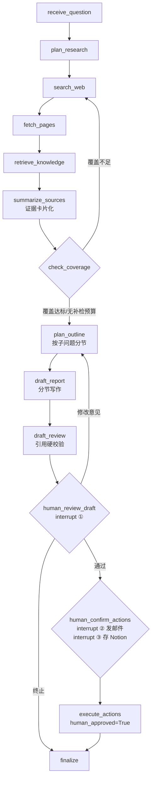

# 研究助手项目总结（PROJECT_SUMMARY.md）

> 快照时间：2026-11-09
> 代码位置：`D:\Build\AI-hy`
> 当前状态：P0「研究质量闭环」、网页「模型设置」、P0-1「会话持久化与多轮」、P0-2「Trace + 成本归因」、P0-3「混合检索 RAG」、**报告质量闭环（证据卡片化 → 大纲 → 分节写作 → 引用硬校验）**、**体验闭环（多轮追问 / 取消运行 / 知识库面板）**、**性能与可靠性（缓存 / 并发抓取 / 写操作幂等）**、**交付物（Word 导出 / 历史检索 / 成本看板 / 报告 diff）**、**运行时性能修复（超时放大 / 分节并发 / 耗时归因）**、**抓取失败降级（搜索摘要级证据 / 垃圾结果过滤）**、**Prompt 护栏（知识库防污染 / 对比矩阵与冲突消解 / ≤1000 字与重复事实约束）**均已落地，并通过 **262 个测试**、9 项功能验收、6/6 知识库验收；工作区与远端一致（最新提交见 `git log -1`）。

---

## 1. 项目一句话

一个**只做研究助手窄场景**的 Agent：接收研究问题 → 拆解检索计划 → 联网搜索 → 抓取正文 →
提取证据 → 生成带引用报告 → **三处人工确认** → 发送邮件 / 保存 Notion → 输出最终结果。

设计目标是「可运行的 MVP」，不是通用 Agent 框架：工具固定 5 个，写操作必须人工确认，
没有来源时宁可写「未找到可靠来源」也不编造。

## 2. 技术栈与规模

| 项目 | 内容 |
| --- | --- |
| 语言 / 运行环境 | Python 3.14.5，项目虚拟环境 `D:\Build\AI-hy\.venv` |
| 工作流 | LangGraph（`StateGraph` + `interrupt` + `SqliteSaver` checkpointer，14 节点） |
| 大模型 | OpenAI / 兼容 OpenAI 的接口（`.env` 或网页「模型设置」均可配置，网页配置只存进程内存） |
| 工具调用 | OpenAI SDK Function Calling；网关不支持 tools 时回退 JSON 输出 |
| 检索 | 联网搜索 + 本地知识库混合检索（BM25 + 可选向量 + RRF，`rag.py`） |
| 可观测性 | 节点 Span（`tracing.py`）+ 模型价目表成本归因 + Web 调用链瀑布 |
| Web | FastAPI + Uvicorn + 深色主题单页 `index.html`（NDJSON 流式日志；右上角可填 Key/Base/模型） |
| 网页处理 | requests + BeautifulSoup + charset-normalizer |
| 评测 | 自研 40 题数据集 + mock/真实联网/真实 LLM 三种模式 |
| 代码规模 | `graph.py` ~1633 行、`tools.py` ~1007 行、`llm_client.py` ~916 行、`web.py` ~732 行、`reporting.py` ~582 行、`persistence.py` ~336 行、`quality.py` ~296 行、`tracing.py` ~232 行、`docx_export.py` ~214 行、`rag.py` ~389 行、`cache.py` ~113 行、`index.html` ~3782 行 |
| 质量状态 | 262 个 pytest 用例通过；9 项功能闭环验收 9/9；6/6 知识库验收；40 题真实联网评测完成；会话可跨进程恢复；报告有引用硬校验与回退保护；写操作有审计与幂等；搜索/抓取有 TTL 缓存与并发抓取；LLM 长输出超时分档、分节写作并发、总耗时拆分为计算/人工等待；正文抓取全失败时降级为搜索摘要并显式标注；对比问题强制表格、知识库不污染外部产品结论 |

## 3. 目录结构

```text
AI-hy/
├── 原型图/               # 页面原型/界面截图（22 张，原 docs/）
├── 开发文档/             # 接口文档、数据库设计、OPTIMIZATION、验收/评测报告
├── frontend/             # 前端代码索引（代码仍在根目录）
├── backend/              # 后端代码索引（代码仍在根目录）
├── docs/                 # 已迁移，仅保留指向 原型图/ 的索引
│
├── graph.py              # LangGraph 图：14 个节点 + 条件边 + 3 处 interrupt + checkpointer
├── state.py              # ResearchState TypedDict、初始状态、质量闭环字段
├── quality.py            # 子问题覆盖度 + claim→quote 支持性校验
├── reporting.py          # 证据卡片化 + 大纲 + 引用硬校验/程序修复
├── rag.py                # 知识库分块 + BM25 + 可选向量 + RRF + 索引缓存
├── tracing.py            # 节点 Span + 模型价目表成本归因
├── tools.py              # 5 个工具、JSON Schema、重试/退避/熔断、SSRF、写操作门禁
├── llm_client.py         # OpenAI Function Calling 客户端 + 离线启发式回退
├── prompts.py            # 规划 / 证据 / 报告提示词
├── text_clean.py         # 网页编码探测 + 乱码清洗
├── logging_utils.py      # 结构化日志（state + JSONL）与实时日志订阅
├── human_review.py       # 命令行人工确认（草稿 / 写操作参数）
├── main.py               # CLI 入口（interrupt → resume 循环）
├── web.py                # Web 入口（FastAPI，复用同一张图与门禁）
├── cancel.py             # 协作式取消登记表（节点边界生效，不强杀线程）
├── cache.py              # 搜索/抓取 TTL 缓存（SQLite，默认 24h）
├── docx_export.py        # 报告 Markdown → Word(.docx) 导出
├── persistence.py        # SQLite checkpointer + 会话索引表 + 写操作审计/幂等表
├── index.html            # 单页前端：双击演示，或由 web.py 托管连真实后端
├── launch.html           # 一键启用启动页（探活 → 进主界面并弹模型设置）
├── start.bat             # Windows 一键启动：起 web.py + 自动打开启动页
├── check_llm.py          # 真实 LLM 配置自检
├── evaluation/           # 40 题评测集、跑分、验收脚本、mock fixture
├── knowledge/            # 本地知识库（3 篇 md）
├── config/pricing.json   # 模型价目表
├── data/ logs/ outbox/   # 运行期产物（gitignore）
├── tests/                # 42 个测试文件 / 262 个用例
├── README.md             # 使用与验收文档
├── PROJECT_SUMMARY.md    # 本文
├── requirements.txt
├── pytest.ini
└── .env.example          # 环境变量模板（真实 Key 只在被忽略的 .env）
```

：14 个节点 + 3 次人工暂停



| # | 节点 | 作用 |
| --- | --- | --- |
| 1 | `receive_question` | 校验问题、记录 LLM 模式、初始化 token 基线 |
| 2 | `plan_research` | Function Calling/JSON/启发式生成 2~3 条 query + 3~5 个子问题 |
| 3 | `search_web` | 多提供方搜索、URL 去重、多轮合并；第二轮只跑缺口 query |
| 4 | `fetch_pages` | 自适应页数、候选重排、编码/正文清洗、URL + 内容指纹去重 |
| 5 | `retrieve_knowledge` | 知识库混合检索；按问题词面过滤无关片段 |
| 6 | `summarize_sources` | 提取证据 → claim→quote 校验 → **证据卡片化**（子问题/类型/去重/营销标记） |
| 7 | `check_coverage` | 计算子问题覆盖度；不足时生成 gap query，最多补 1 轮 |
| 8 | `plan_outline` | **新增**：LLM/规则大纲，按子问题分节并分配 `[S#]`；修改意见先改大纲 |
| 9 | `draft_report` | **分节写作**：摘要「结论→依据→边界」、关键发现程序生成、推演单独成节 |
| 10 | `draft_review` | **新增**：引用/结构硬校验 → 模型最小改动重写（更差则丢弃）→ 程序剪枝/补节 |
| 11 | `human_review_draft` | **interrupt ①**：通过 / 修改 / 终止；支持人工改稿（API 层） |
| 12 | `human_confirm_actions` | **interrupt ②③**：发邮件前、存 Notion 前分别确认 |
| 13 | `execute_actions` | 只对已确认动作调用写工具，`human_approved=True` 只在这里出现 |
| 14 | `finalize` | 状态、报告、来源、证据、覆盖率、支持率、草稿校验、token/成本/耗时、日志摘要 |

### 三处人工暂停

| 暂停点 | 决策 | 结果 |
| --- | --- | --- |
| 草稿审核 | `approve` / `revise` / `terminate` | 通过 → 写操作确认；修改 → 重新生成（最多 2 轮）；终止 → 直接 finalize |
| 发邮件前 | `send: true/false` | 同意且有收件人才执行；否则跳过 |
| 存 Notion 前 | `save: true/false` | 同意且标题非空才执行；否则跳过 |

图编译时挂 checkpointer，`invoke` 返回 `__interrupt__`，用 `Command(resume=...)` 恢复。
当前挂的是 **`SqliteSaver`**（`data/checkpoints.sqlite`）：服务重启后仍能从同一个人工审批中断处继续。

## 5. 五个工具

| 工具 | 类型 | 实现要点 |
| --- | --- | --- |
| `search_web` | 读 | Bing / 360 / DuckDuckGo / Wikipedia 回退；中文宽泛问题优先 360；提供方熔断、重试 |
| `fetch_page` | 读 | SSRF 防护（内网 IP/重定向复检）、编码探测、正文抽取、广告/导航/脚本清理 |
| `summarize_sources` | 读 | LLM 证据提取；不可验证引用丢弃；无 Key 时离线逐句抽取 |
| `send_email` | 写 | 配置 SMTP 时真实发送；否则 dry-run 落盘 `.eml`；必须 `human_approved=True` |
| `save_to_notion` | 写 | 配置 Notion API 时真实写入；否则 dry-run 落盘 Markdown；必须 `human_approved=True` |

写操作门禁在 `tools.call_tool()` 统一执行：未确认直接 `WriteActionNotApproved`；
参数里伪造 `human_approved` 无效；确认前 outbox 必须为空（测试断言）。

## 6. 关键机制

### 6.1 结构化状态与日志

`ResearchState` 覆盖：问题、计划、搜索结果、抓取页面、证据、草稿、人工反馈、已批准动作、
邮件/Notion 载荷、日志、错误、重试计数、最终输出，以及 P0 字段：
`coverage / coverage_summary / verification / retrieval_round / gap_queries`。

每条日志固定字段：

```text
step_id, node_name, tool_name, input_summary, output_summary,
status, retry_count, latency_ms, error, timestamp, trace_id
```

日志同时写入 `state.logs` 和 `logs/research-<trace_id>.jsonl`；Web 端通过日志 sink
以 NDJSON 实时推给浏览器。

### 6.2 引用完整性（防编造）

1. `filter_evidence`：URL 必须在抓取集合、quote 必须逐字命中正文、拒绝半截句子；
2. P0 `verify_evidence`：claim 必须能被 quote 支持（逐字/重叠/数字/实体/否定一致性），
   明显无关的“证据”会被过滤并记录；
3. `_sanitize_report`：删除模型自写来源章节、未抓取 URL 降级/移除、按证据重建来源清单；
4. 无证据时强制写入「未找到可靠来源」。

### 6.3 LLM 双模式

- `openai`：真实 chat completions；规划优先 Function Calling，失败回退 JSON，再失败降级启发式；
- `offline`：无 Key 时启发式规划、逐句证据、模板报告，保证完整流程可跑；
- `AGENT_LLM_MODE=auto`（默认）：有 Key 用 openai，否则 offline。

### 6.4 网页清洗与编码

`text_clean.py` 按 BOM → UTF-8 → 声明编码 → charset_normalizer → gb18030 → gbk(ignore)
顺序解码；`mojibake_ratio` 识别乱码块；`clean_text_blocks` 去广告/导航/脚本/重复段落。
整页乱码会确定性失败，不“猜”内容。

### 6.5 P0 研究质量闭环（本轮新增）

| 能力 | 实现 | 作用 |
| --- | --- | --- |
| 子问题覆盖度 | `quality.compute_coverage()` | 英文实体 + 中文语义块，逐子问题判断 evidence 是否覆盖 |
| 缺口补检 | `check_coverage` 节点 | 覆盖率 < 75% 时用未覆盖子问题生成 query，最多补 1 轮 |
| 抓取自适应 | `_page_target()` / `_rank_bonus()` | 对比/多跳扩页；按问题词 + 官方站点先验重排 |
| 内容去重 | `_content_fingerprint()` | 拦截转载/镜像正文，避免重复证据 |
| 断言校验 | `quality.verify_evidence()` | claim→quote 支持性判定：supported / partial / unsupported |
| 质量指标 | `final_output` + `run_eval` | 覆盖率、支持率、检索轮次进入结果与评测报告 |

### 6.6 会话持久化与多轮（P0-1，2026-11-09）

| 能力 | 实现 | 作用 |
| --- | --- | --- |
| 断点恢复 | `persistence.build_checkpointer()` → `SqliteSaver` | 服务重启后从草稿/邮件/Notion 中断处 `resume` |
| 会话索引 | `SessionStore`（`data/sessions.sqlite`） | 历史会话列表、状态、父会话、更新时间 |
| 历史 API | `GET /api/sessions`、`GET /api/sessions/{thread_id}`、`DELETE /api/sessions/{thread_id}` | 页面「历史会话」抽屉，中断态点击「继续审批」；单条删除会连 checkpoint 一起清 |
| 执行中断 | 流首行 `start` 事件带 `thread_id`；断流 → 进度冻结标红 + 「会话未完成」卡片；`POST /api/sessions/{id}/interrupt` 落库；启动时把遗留 `running` 标 `interrupted` | 后端被杀/断网不再伪装成「完成」或一直「进行中」 |
| 多轮追问 | `POST /api/research {"parent_thread_id": ...}` | 父会话结论摘要注入 `history_context`（≤1200 字符），规划时避免重复检索 |
| 前端 | 右上角「历史会话」+ `?history=1` / `?session=<id>` 深链 | 演示与排障可直接打开指定会话 |

### 6.7 调用链 Trace 与成本归因（P0-2，2026-11-09）

| 能力 | 实现 | 作用 |
| --- | --- | --- |
| 节点 Span | `graph._instrument` 包住全部 12 个节点 → `logs/<trace_id>.trace.jsonl` | 节点耗时 / token / 成本 / 错误 |
| 成本归因 | `tracing.estimate_cost` + `config/pricing.json`（最长前缀匹配） | `cost_by_node`、`cost_estimated`、`cost_price_source` 进 `final_output` |
| 查询 API | `GET /api/trace/{trace_id}`、`GET /api/cost/summary?days=7` | 前端瀑布图；按天/按模型聚合 |
| 前端 | 结果页「调用链 Trace」卡片（耗时条 + 每节点 token/成本） | 排障从翻日志变成看瀑布 |

### 6.8 本地知识库混合检索（P0-3，2026-11-09）

| 能力 | 实现 | 作用 |
| --- | --- | --- |
| 分块 | 按标题切段 + 800 字 / 120 重叠，保留 heading | 中文语义块完整，引用可定位到小节 |
| 召回 | BM25（中文 bigram + 英文词） | 无 embedding 也可用 |
| 向量 | OpenAI 兼容 `/embeddings`（默认 `text-embedding-3-small`，智谱 `embedding-3`） | 语义召回 |
| 融合 | RRF（`Σ 1/(60+rank)`） | 两路排名合并，无需调权重 |
| 降级 | 无 Key / 调用失败 → 纯 BM25；无文档 → 节点 skipped | 不阻塞研究主流程 |
| 接入 | `retrieve_knowledge` 节点把命中片段转成 `kb://` 来源追加进 `fetched_pages` | 复用证据抽取 / 引用 / 校验 |
| 验收 | `evaluation/kb_check.py`：只给 `knowledge/`、不联网 | **6/6 passed** |

### 6.9 报告质量闭环：证据卡片 → 大纲 → 分节写作 → 引用校验（2026-11-09）

实测四个问题：**摘要太水 / 逻辑割裂 / 引用堆叠错误 / 缺乏推演**。对应四层改造（新增 `reporting.py`）：

| 能力 | 实现 | 治什么 |
| --- | --- | --- |
| 证据卡片化 | `summarize_sources` → `reporting.enrich_evidence`：`sub_question` / `kind` / `promo` / 同义合并（`merged_count`、`merged_urls`） | 引用堆叠：同页同义证据不再反复出现，营销话术不再当主要依据 |
| 大纲规划 | 新增 `plan_outline` 节点：LLM 输出 `{sections:[{title,goal,evidence_ids}]}`，失败回落规则大纲；`uncovered` 只保留真没证据的子问题 | 逻辑割裂：一节只写一个子问题，不再“一个来源一段” |
| 分节写作 | `draft_report` 按节调用，每节只喂本节证据（编号仍是全局 `[S#]`）；摘要独立提示词（结论→依据→边界）；「关键发现」由程序按证据生成；推演单独成节、每条【推断】 | 摘要太水 / 缺乏推演 |
| 引用硬校验 | 新增 `draft_review` 节点：编号越界、单句 >2 角标、引用与句子无词面关联、关键发现无引用、摘要空判断、小节缺失；不达标让模型最小改动重写一次，**问题更多就丢弃**，再程序剪枝/补节 | 引用堆叠错误；防止“修引用”把报告改坏 |

结果写入 `final_output.draft_review`（`status / issues / rewrites / rejected_rewrites / remaining_issues`）与
`final_output.outline`；两个消融开关 `AGENT_EVIDENCE_CARDS`、`AGENT_DRAFT_REVIEW`。
另外 `retrieve_knowledge` 增加问题词面相关性门槛：与问题无交集的 KB 片段不再进入证据链
（实测会把本项目自己的 RAG 设计文档混进“LangGraph vs AutoGen”报告）。

### 6.10 体验闭环：多轮追问 / 取消运行 / 知识库面板（2026-11-17）

| 能力 | 实现 | 解决的问题 |
| --- | --- | --- |
| 多轮追问入口 | 终稿卡与报告页「继续追问」→ 前端把 `parent_thread_id` 随 `/api/research` 发出；支持 `/app?follow=<tid>` 深链；历史列表显示「↳ 追问自」 | 后端早已支持多轮，但页面上没有入口，宣称的能力点不到 |
| 取消运行 | `cancel.py`（`threading.Event` 登记表）+ `graph._instrument` 节点入口检查并抛 `ResearchCancelled`（不写 error span）；`POST /api/sessions/{tid}/cancel` + 流式 `cancelled` 终态 + 会话状态 `cancelled`；前端 AbortController | 15~30s 的运行原来只能等或杀后端；取消后界面显示「已取消 · N%」而不是误报断网 |
| 知识库面板 | `rag.knowledge_documents()` + `GET /api/kb`、`POST /api/kb/reindex`；设置弹层列出文档/分块/向量状态并可一键重建索引 | RAG 原来只有接口没有可见入口，改了 `knowledge/` 也不知道是否生效 |

取消的语义取舍写在 `cancel.py` 头部：**不杀线程**，只在节点边界生效，
避免半写 checkpoint / 半落 outbox；最坏延迟受节点 HTTP 预算约束（约 15~20s）。

### 6.11 性能与可靠性：缓存 / 并发抓取 / 写操作幂等（2026-11-17）

| 能力 | 实现 | 效果 |
| --- | --- | --- |
| 搜索/抓取 TTL 缓存 | `cache.py`：SQLite `cache(kind, key_hash, value, created_at)`；只缓存成功结果；`AGENT_CACHE_ENABLED` / `AGENT_CACHE_TTL` | 同一问题二次运行实测 **23.8s → 3.4s**（4 个页面全部命中缓存） |
| 并发抓取 | `graph._fetch_batch()` + `ThreadPoolExecutor`，按排名分批（默认 3，`AGENT_FETCH_CONCURRENCY` 夹取 1~6），结果按提交顺序归并 | 最终页面集合与串行版一致；并发度 1 完全退回旧行为（可回归对比） |
| 写操作审计 + 幂等 | `persistence.WriteAuditStore`：`write_actions(run_key, action, payload_hash, status, mode, detail, …)` + 唯一索引；`execute_actions` 执行前查询同参数是否已成功 | 修复“写成功后进程被杀、恢复时节点重跑导致重复发邮件/重复写 Notion”的真实风险；参数改过仍会正常执行 |
| 控制台编码兜底 | `logging_utils.ensure_utf8_stdout()`，`web.py` / `main.py` 启动时调用 | 修复 GBK 控制台打印 `¥` 触发 `UnicodeEncodeError`、把一次正常运行标成 failed |

### 6.12 交付物：Word 导出 / 历史检索 / 成本看板 / 报告 diff（2026-11-17）

- **Word 导出**：`docx_export.py`（Markdown → docx：标题/段落/列表/引用/粗体/行内代码/
  `[S#]` 上标/超链接/表格 + 证据表附录），`GET /api/sessions/{tid}/export.docx`；
  依赖 `python-docx`，懒加载，未安装返回 503 而不是让服务起不来。
- **历史检索**：`SessionStore.list(query, status)` + `GET /api/sessions?q=&status=`，
  前端历史卡加搜索框（300ms 防抖）与状态下拉。
- **成本看板**：复用 `/api/cost/summary`，前端弹窗展示近 7/30 天运行数 / 调用次数 /
  token / 成本，按模型表 + 按天条形图。
- **报告 diff**：`_diff_reports()` 纯函数（只比正文、去掉来源清单、上限 200 行），
  `GET /api/sessions/{tid}/diff`；报告页「与上一轮对比」展开红绿差异。

### 6.13 运行时性能修复：超时放大 / 串行写作 / 耗时归因（2026-11-23）

一次真实运行（`trace_id=7914d6b6`，glm-4-flash）总耗时 **419.3s**，逐节点拆账发现：
`summarize_sources` 两轮各 **121.3s / 121.6s**（占 58%）却都因超时降级成启发式；
`draft_report` 80.3s 为 6 次串行调用；另有 50.5s 是人工确认等待却被算进“总耗时”。

| 问题 | 根因 | 修复 | 效果 |
| --- | --- | --- | --- |
| 一次 30s 超时被放大成 121s | `max_retries=1`（×2）叠加 `_chat` 去掉 `response_format` 重试（×2）= 4×30s；而 glm-4-flash 输出 750 token 实测就要 27~33s | 超时只发一次请求、不再格式回退；**只有 400/422 才回退纯文本**；429/5xx/连接错误快速重试一次；SDK `max_retries=0`；长输出调用单独 `AGENT_LLM_TIMEOUT_LONG=75`（证据提取/大纲/写作/重写） | 同一证据提取调用：**121.3s + 降级 → 33.2s 成功**（mode=openai，6 条证据） |
| 工具预算形同虚设 | `call_tool` 的 deadline 只在重试之间检查，单次阻塞调用可任意超时 | `AGENT_SUMMARIZE_TIMEOUT` 与 LLM 超时共用（75s），预算与真实超时一致 | 不再出现“预算 25s、实际 121s” |
| 分节写作串行 80s | 摘要/分析/4 个自定义小节逐个调用 | `ThreadPoolExecutor` 并发（`AGENT_DRAFT_CONCURRENCY` 默认 3，夹取 1~4），按大纲顺序拼装，`previous_titles` 预计算保持提示词不变；token 累计加锁 | 6 次调用 80.3s → 约 20~30s；并发与串行输出逐字节一致（测试保证） |
| 419s 里混进 50s 人工等待 | `duration_ms` 直接取墙钟差 | `finalize` 用 span 耗时之和算 `compute_ms`，差值算 `hitl_wait_ms`；前端展示「总耗时 / 其中人工确认等待」，Word 导出同样拆分 | 计算 368.8s + 人工 50.5s 一眼看清 |
| trace 时间线错乱 | span `started_at` 写成了完成时刻 | 用「结束时刻 − 耗时」还原开始时间 | 时间线不再重叠/负间隔 |
| 写操作确认后失败 | 收件人格式只在执行时校验 | `human_confirm_actions` 在暂停点用 `EMAIL_RE` 校验，非法直接跳过并记 `invalid_email_to` | 不再出现“完成（写操作失败）”式收尾 |

修复后端到端实测（**真实 glm-4-flash + 本地固定 3 页面**，排除外网抓取波动；`trace_id=3f40a11e`）：
总耗时 **48.4s**（计算 48.4s / 人工等待 0.05s），`summarize_sources` **13.0s 且 mode=openai**，
`plan_outline` 14.3s，`draft_report` 6 次调用 **15.5s**，3 来源 / 3 证据 / 覆盖 5/5。

### 6.14 抓取失败降级：垃圾结果过滤 + 搜索摘要级证据（2026-11-23）

用户反馈“完成（无可靠来源）、内容太少”。排查一次真实运行（`trace_id=8742bda5`）：
8 个候选 URL 全部失败——CSDN 返回 **HTTP 521**、知乎 **403**、`tv.360kan.com`/`ai.so.com`
是视频/搜索聚合页（无正文）、DuckDuckGo 与 Wikipedia 在当前网络**连接超时**，
Bing 对“2027”这类问题返回节假日/百科噪声，只有 so360 可用但结果多为不可抓取站点。

| 问题 | 修复 | 效果 |
| --- | --- | --- |
| 搜索结果里有视频站/搜索引擎聚合页，浪费抓取预算 | `_is_junk_result_url()`：剔除 `*.360kan.com`、`*.so.com/search`、Bing/Baidu/Google 搜索页；抓取候选二次防御 | 每次检索少试 1~2 个必失败的 URL，日志显示“过滤 N 条视频/搜索聚合页” |
| 正文全失败时直接交白卷 | 零页时用搜索摘要拼“摘要级页面”（`snippet_only=True`，最多 6 条、同域最多 2 条、摘要 ≥40 字） | 不再出现“0 来源 0 证据”的空白报告 |
| 只抓到 1 页时内容仍然太薄 | 正文页数 < 目标页数时，用**未抓取 URL 的搜索摘要补齐**到目标页数 | 1 页正文 + 3 条摘要 → 报告有 5 条以上证据可写 |
| 摘要证据容易被误当全文 | 证据逐条带 `snippet_only`；`evidence_note` 与报告「局限」写明“仅来自搜索摘要、需复核原文”；UI 报告页显示警告 chip；`final_output` 新增 `snippet_only` / `snippet_evidence_count` | 降级可解释、可追溯，不冒充全文证据 |

**实测**：同一问题真实运行（`trace_id=bcc0e12a`）拿到 1 个正文页 + 补入搜索摘要后，
`summarize_sources` 33.3s、5 条证据、支持率 100%，状态从 `completed_no_sources` 变为 `completed`；
报告有摘要/关键发现/推演/局限四节，来源带链接。彻底 0 页时仅用摘要，报告明确标注需复核原文。

### 6.15 Prompt 护栏：知识库防污染 / 对比矩阵 / 篇幅与重复（2026-11-25）

针对三类“报告不可用”的反馈做 Prompt + 程序双重约束：

| 问题 | 修复 | 位置 |
| --- | --- | --- |
| 问外部产品（如 Chroma vs Milvus）时，本地项目文档（RAG 设计、评测指标）被当成产品结论 | 对比/外部问题**默认不召回本地知识库**；仅当问题带“本项目/我们的方案”等上下文才保留，并把 KB 片段标 `source_scope=project`、证据块注明「本地项目文档」；系统提示词新增「本地知识库使用规则」：项目文档不得当外部产品/框架的通用能力、性能参数或行业事实 | `graph.retrieve_knowledge`、`_kb_evidence_items`、`prompts.KB_SCOPE_RULE` |
| 对比分析写成一团散文：没有表格、把 A 的属性写到 B 上、冲突不解释 | 对比类问题注入【对比报告专属指令】：①强制 Markdown 表格（维度 × A × B，≥3 维度）②严禁身份混淆，做不到写「证据不足」③冲突消解（官方与第三方说法都要写清适用条件）④拒绝空评价；`plan_outline` 要求单开「对比矩阵」一节；`draft_review` 对对比报告缺表格判 `missing_comparison_table` 并触发重写 | `prompts.comparison_instructions`、`OUTLINE_SYSTEM`、`reporting.has_markdown_table` |
| 报告又长又重复（同一事实反复唠叨） | Prompt 硬约束：正文 ≤1000 字、同一事实全文最多两次；`draft_review` 记 `report_too_long` / `repeated_fact`；**确定性压缩** `compact_report()`：摘要 3 句、发现 ≤5 条、推演 ≤2 条、重复事实句最多两次、重复表格小节只留一个、超限再从尾部删非必需小节（必需小节与对比表格保留），不依赖模型配合 | `prompts.DRAFT_SYSTEM`、`reporting.compact_report`、`graph.draft_review` |

**实测（真实 glm-4-flash + 真实联网，`trace_id=58156c70`）**：
- 两轮检索都命中“对比/外部产品问题 → 跳过知识库”（`retrieve_knowledge` 日志）；
- 大纲 8 节，含「Chroma 和 Milvus 的区别 / 应用场景 / 中小团队选择 RAG 的考虑因素 / 对比矩阵」；
- 草稿 4627 字符（模型明显超字数）→ `draft_review` 5 个初检问题 → 重写 1 次 + 程序修复 8 处 → 通过；
  `compact_report` 删掉 3 个重复表格小节、压缩关键发现与推演，最终正文 **806 字**（引用链接 URL 不计入字数），
  保留 1 个对比表格，`status=passed`；
- 对照修复前同问题运行（`trace_id=7d70db4a`）：5342 字符、4 个重复表格、无字数控制。

## 7. 评测与验收结果

### 7.1 真实联网 40 题（离线 LLM + 真实检索，未调用付费 API）

| 指标 | P0 前（`real_after_360`） | P0 后（`real_p0`） |
| --- | --- | --- |
| 任务成功率 | 82.5% | **85.0%** |
| 多跳类成功率 | 60.0% | **70.0%** |
| 对比类成功率 | 70.0% | 70.0% |
| 引用可追溯率 | 100% | 100% |
| 关键结论可点击率 | 100% | 100% |
| 工具调用正确率 | 87.5% | **90.0%** |
| 事实覆盖（宽松代理） | 21.2% | **26.3%** |
| 子问题证据覆盖率 | 未统计 | **51.2%**（未达 75% 目标） |
| 证据断言支持率 | 未统计 | **99.4%**（规则代理） |
| 平均检索轮次 | 1.0 | **1.68** |
| 平均 / P95 延迟 | 9.8s / 19.8s | 15.6s / 26.7s |

来源：[开发文档/eval_report.md](开发文档/eval_report.md)；原始数据在 `evaluation/results/real_p0.*`。

### 7.2 mock 流水线评测（确定性 fixture）

| 指标 | 结果 |
| --- | --- |
| 任务成功率 | 100%（40/40） |
| 引用可追溯 / 可点击 | 100% / 100% |
| 子问题覆盖率 | 90.0% |
| 证据断言支持率 | 100% |
| 平均检索轮次 | 1.15 |
| 平均 / P95 延迟 | 21ms / 25ms |

mock 只验证流水线机制（搜索→抓取→证据→报告→引用→人工确认），不代表真实检索质量。

### 7.3 功能验收与测试

- `evaluation/acceptance_check.py`：**9/9 通过**，覆盖问题拆解、联网搜索、抓取清洗、证据表、
  结构化报告、引用校验、三处人工暂停 + 写门禁、重试降级、可观测；
- `pytest`：**262 passed**（含 P0 覆盖度/补检/断言校验、Web 模型配置、P0-1 持久化/多轮/删除、P0-2 Trace/成本、P0-3 RAG、报告质量 21 例、中断与会话删除、多轮追问、取消运行、知识库接口、缓存/并发/幂等、Word 导出、历史检索、成本看板、报告 diff、超时策略/分节并发/耗时拆分/trace 时间戳/邮箱预校验、抓取失败降级/摘要级证据、Prompt 护栏/对比表格/知识库防污染/字数与重复约束）。

## 8. 运行方式

### 8.1 安装

```bash
python -m venv .venv
.venv\Scripts\activate          # Windows
pip install -r requirements.txt
copy .env.example .env           # 填入 OPENAI_API_KEY / BASE_URL / MODEL
```

### 8.2 配置自检

```bash
python check_llm.py             # 检查 .env、依赖、模式；会真实调用一次模型
python check_llm.py --dry-run    # 只做配置检查
```

启动 `web.py`/`check_llm.py` 时如果系统 Python 缺依赖，会自动切换到项目 `.venv`。

### 8.3 运行

```bash
# 网页版：启动后访问 http://127.0.0.1:8000，右上角「模型设置」可直接填 Key/Base/模型
# Key 只存后端进程内存，不写 .env、不回传明文，重启失效；页面只显示掩码。

# 命令行（人工确认）
python main.py "LangGraph 如何实现人工中断？"

# 命令行（演示/CI 自动批准）
python main.py "LangGraph 如何实现人工中断？" --auto

# 网页版
python web.py                    # 启动页 http://127.0.0.1:8000/
                                 # 主界面 http://127.0.0.1:8000/index.html（/app 同）
# 或
uvicorn web:app --host 127.0.0.1 --port 8000

# 一键启用（Windows）：起后端 + 自动打开启动页
start.bat
```

启动页 `launch.html` 探测 `/api/health` 后一键进入主界面并自动弹出模型设置；双击
`launch.html`（file://）时降级为「一键启用（静态演示）」。**根路径 `/` 就是启动页**，
主界面在 `/index.html`（`/app` 等价，供启动页相对深链与旧书签使用）。

`index.html` 也可直接双击作为静态演示（不连后端）。

### 8.4 测试与评测

```bash
# 全量测试
pytest -q

# mock 流水线评测
python evaluation/run_eval.py --mode mock --tag mock_p0

# 真实联网评测（40 题，约 10~15 分钟）
python evaluation/run_eval.py --mode real --tag real_p0

# 汇总报告
python evaluation/make_report.py

# 9 项功能验收
python evaluation/acceptance_check.py
```

### 8.5 主要环境变量

| 变量 | 说明 |
| --- | --- |
| `OPENAI_API_KEY` / `OPENAI_BASE_URL` / `OPENAI_MODEL` | 模型接入；Key 留空进入离线模式 |
| `AGENT_LLM_MODE` | `auto` / `openai` / `offline` |
| `AGENT_MAX_PAGES` / `AGENT_MAX_PAGES_HARD` | 基础抓取页数（3）/ 自适应硬上限（6） |
| `AGENT_MAX_RETRIEVAL_ROUNDS` | 总检索轮次上限，默认 2 |
| `AGENT_COVERAGE_MIN` / `AGENT_COVERAGE_THRESHOLD` | 触发补检阈值 0.75 / 单子问题覆盖阈值 0.6 |
| `AGENT_MAX_GAP_QUERIES` | 一次补检 query 上限，默认 2 |
| `AGENT_EVIDENCE_MAX` / `AGENT_EVIDENCE_PER_SOURCE` | 离线证据总条数/每来源条数，默认 16 / 3 |
| `AGENT_TOOL_MAX_ATTEMPTS` / `AGENT_RETRY_BASE_DELAY` | 重试次数（3）/ 退避基数（0.5s） |
| `AGENT_SEARCH_TIMEOUT` / `AGENT_FETCH_TIMEOUT` | 单次工具超时预算 |
| `AGENT_OUTBOX_DIR` | dry-run 写操作落盘目录，默认 `outbox/` |

## 9. 已知限制与风险

1. **会话仍受单机限制**：SQLite checkpointer 只适合单进程；多 worker/多实例需换 `PostgresSaver`，且没有鉴权与限流。
2. **写操作默认 dry-run**：未配置 SMTP/Notion 时只落盘模拟，不会真实发送/同步。
3. **检索质量是瓶颈**：真实评测子问题覆盖率 51.2%，主要卡在对比题只抓到一方、站点 403/521/JS 空页。
4. **断言支持率是规则代理**：99.4% 不代表语义蕴含，不能替代人工审计；高抽象改写可能被误判。
5. **延迟**：首次单题平均 15.6s、P95 26.7s（离线 LLM 评测口径）；真实 LLM 慢在 token 生成
   （glm-4-flash 约 23 token/s），一次 2 轮运行实测 419s = 计算 369s + 人工等待 50s，
   其中 243s 曾被超时放大浪费；修复见 §6.13（证据提取 121s→33s、分节 80s→约 20~30s）。
   同一问题再次运行命中缓存可降到 ~3s。
6. **真实 LLM 未全量评测**：40 题仍是离线 LLM（token/成本为 0）；真实模型只做过 1 题 smoke
   （`llm_smoke`），接入后需重跑。
7. **单机单用户**：无登录、无多用户隔离；历史会话有列表/恢复/删除/检索，但没有独立报告库与权限。
8. **工程化仍不足**：依赖未锁定、无 CI、无 Docker；搜索/抓取已有缓存与并发（默认 3），但抓取仍受站点 403/JS 空页限制。
9. **安全**：`.env` 含真实 Key，已在 `.gitignore` 中；网页填写的 Key 只存进程内存、页面只显示掩码，不会写回 `.env`，但不要暴露到公网。
10. **SQLite 并发**：单写者模型，WAL 下小流量够用；不要用多个 uvicorn worker 同时跑。
11. **知识库规模**：向量用纯 Python 余弦，约 1 万 chunk 上限；embedding 需要服务提供 `/embeddings`（DeepSeek 不提供，可换智谱 `embedding-3` 或只用 BM25）。
12. **价目表需维护**：`config/pricing.json` 手写，模型调价后要更新；未录入模型按 env 单价估算并标记。`glm-4-flash` 等免费模型成本真实为 0。
13. **Trace 落盘**：`logs/<trace_id>.trace.jsonl` 与 JSONL 日志同目录，长期运行需要清理策略。
14. **报告质量仍依赖模型**：分节写作拆成 5~6 次调用（已并发，默认 3）仍受模型吐字速度限制，
   长输出调用 75s 超时后会降级；引用校验只能查“格式与词面相关”，查不出“结论对但因果说错”；
   重写被丢弃时仍会留下 1~10 个已知问题（写入 `draft_review`，不阻塞流程）。
15. **中断后只能重跑，不能续跑**：checkpoint 只保证“人工审批点可恢复”；如果进程在普通节点执行中
   被杀（还没到 interrupt），这次运行会被标成 `interrupted`，可以重新开始或删除会话，但不能从第 N 步接着跑。
16. **取消是协作式的**：只在节点边界生效（当前节点若在 HTTP 预算内，最迟约 15~20s 停下），
    不强杀线程；取消后会话标 `cancelled`，同样只能重跑。
17. **Word 导出依赖可选包**：需要 `python-docx`（已写进 `requirements.txt`）；未安装时接口 503，
    其它功能不受影响。
18. **缓存/审计库会增长**：`data/cache.sqlite` 按 TTL 过期（默认 24h），`data/write_audit.sqlite`
    是审计留痕默认不自动清理，长期运行需要归档策略。
19. **报告 diff 只看正文**：不比较来源列表，最多返回 200 行差异（超出标记 `truncated`）。

## 10. 优化路线（详见 [开发文档/OPTIMIZATION.md](开发文档/OPTIMIZATION.md)）

### 下一批 P0（收益最高）

1. **对比题按实体拆分检索**：A/B 分别检索、分别验收覆盖（当前覆盖率最大瓶颈）。
2. **长文选段**：按子问题切段打分，替代“每来源只喂前 1800 字符”。
3. **LLM verifier（可选开关）**：批量做 claim 语义支持校验，规则版保留为降级。
4. **结构化报告**：按子问题分节 + 对比表；自动列出未覆盖子问题。
5. **评测升级**：100 题 + LLM-as-judge（relevance / faithfulness / coverage）+ 30 条人工校准。

### P1 交互与可靠性

- ~~`SqliteSaver` 持久化会话、会话列表/续跑~~（P0-1 已完成）；
- ~~节点级 Trace、成本归因、价目表~~（P0-2 已完成）；
- ~~本地知识库混合检索（BM25 + 向量 + RRF）~~（P0-3 已完成）；
- ~~报告质量闭环：证据卡片化 / 大纲 / 分节写作 / 引用硬校验~~（已完成，见 §6.9）；
- ~~多轮追问入口、取消运行、知识库面板~~（已完成，见 §6.10）；
- ~~搜索/抓取缓存、并发抓取、写操作审计/幂等、GBK 控制台兜底~~（已完成，见 §6.11）；
- ~~Word 导出、历史检索、成本看板、多轮报告 diff~~（已完成，见 §6.12）；
- ~~运行时性能修复：超时放大 / 分节并发 / 耗时归因 / trace 时间戳~~（已完成，见 §6.13）；
- 仍待做：LLM token 流式、页面内改稿、断点续跑（普通节点中断后从第 N 步继续）；
- 真实模型 + LLM-as-judge 评测；提示注入防御。

### P1 工程化

- ~~搜索/抓取缓存、并发抓取（降低 P95）~~（已完成，见 §6.11）；
- PDF 解析、官方搜索 API（Tavily/Bocha/Serper）作为第一提供方；
- 依赖锁定、CI（pytest + mock eval + 前端语法检查）、Docker 部署。

### P2 产品化

- ~~报告导出 Word、历史检索、成本看板、多轮报告 diff~~（已完成，见 §6.12）；
- 服务端 PDF、分享链接（当前为只读报告页 + 打印/PDF）；
- ~~真实 SMTP/Notion 前的幂等键 + 写操作审计~~（已完成，见 §6.11）；
- 登录/多用户/配额、OpenTelemetry/LangSmith trace、指标面板。

## 11. 关键文件索引

| 文件 | 说明 |
| --- | --- |
| [README.md](README.md) | 安装、运行、验收、已知限制 |
| [开发文档/OPTIMIZATION.md](开发文档/OPTIMIZATION.md) | 优化路线图 + P0 实施记录/前后对比 |
| [开发文档/eval_report.md](开发文档/eval_report.md) | 40 题评测报告（指标、失败案例、消融、P0 对比） |
| [开发文档/FUNCTIONAL_ACCEPTANCE.md](开发文档/FUNCTIONAL_ACCEPTANCE.md) | 9 项功能闭环验收报告 |
| [graph.py](graph.py) | 12 节点图、interrupt、条件边、finalize |
| [quality.py](quality.py) | 子问题覆盖度 + claim 支持校验 |
| [reporting.py](reporting.py) | 证据卡片化 / 大纲 / 引用硬校验 / 程序修复 |
| [tools.py](tools.py) | 5 工具、重试/熔断、SSRF、写门禁 |
| [llm_client.py](llm_client.py) | LLM 客户端 + 离线回退 |
| [prompts.py](prompts.py) | 全部提示词 |
| [web.py](web.py) / [index.html](index.html) | Web 后端 / 单页前端 |
| [launch.html](launch.html) / [start.bat](start.bat) | 一键启用启动页 / Windows 启动脚本 |
| [cancel.py](cancel.py) | 协作式取消登记表（节点边界生效） |
| [cache.py](cache.py) | 搜索/抓取 TTL 缓存 |
| [docx_export.py](docx_export.py) | 报告 Markdown → Word 导出 |
| [persistence.py](persistence.py) | SQLite checkpointer + 会话索引（历史/多轮）+ 写操作审计/幂等 |
| [rag.py](rag.py) | 知识库分块 / BM25 / 向量 / RRF / 索引缓存 |
| [tracing.py](tracing.py) | 节点 Span + 模型价目表成本归因 |
| [knowledge/](knowledge/) | 本地知识库文档（3 篇，14 个片段） |
| [evaluation/run_eval.py](evaluation/run_eval.py) | 评测入口 |
| [tests/test_research_quality.py](tests/test_research_quality.py) | P0 覆盖度/补检/断言校验测试 |
| [tests/test_persistence.py](tests/test_persistence.py) | P0-1 重启恢复/历史 API/多轮上下文测试 |
| [tests/test_tracing.py](tests/test_tracing.py) | P0-2 价目表/Span/成本归因/API 测试 |
| [tests/test_rag.py](tests/test_rag.py) | P0-3 分块/BM25/降级/图级知识库来源测试 |
| [tests/test_reporting.py](tests/test_reporting.py) | 报告质量 21 例：卡片化/大纲/引用校验/修复/重写回归保护 |

## 12. 复现命令速查

```bash
# 配置与依赖
python check_llm.py

# 跑一次研究（交互）
python main.py "LangGraph 如何实现人工中断？"

# Web
python web.py

# 测试 / 验收 / 评测
pytest -q
python evaluation/acceptance_check.py
python evaluation/run_eval.py --mode mock --tag mock_p0
python evaluation/run_eval.py --mode real --tag real_p0
python evaluation/make_report.py
```

---

**说明**：本文是当前工作区快照，不替代 `README.md` 的详细说明；数字类结论以
`evaluation/results/real_p0.summary.json`、`mock_p0.summary.json` 与 `开发文档/FUNCTIONAL_ACCEPTANCE.md` 为准。
