# LangGraph 研究助手（Research Assistant MVP）

> 一个只做**研究助手窄场景**的 Agent：研究问题 → 拆解检索 → 联网搜索/抓取 → 提取证据 →
> 生成带引用的报告 → **三处人工确认** → 发邮件 / 存 Notion → 输出最终结果。
>
> 14 节点 LangGraph 图 · 3 次 human-in-the-loop · 引用可回溯 · 断点恢复 · 可观测 Trace/成本 · 本地知识库 RAG

**当前状态**：226 个测试全绿 · 9 项功能验收 9/9 · 知识库验收 6/6 · 真实联网 40 题评测已完成

---

## 目录

- [这是什么](#这是什么)
- [3 分钟跑起来](#3-分钟跑起来)
- [界面与用法](#界面与用法)
- [核心能力](#核心能力)
- [架构与流程](#架构与流程)
- [评测数据](#评测数据)
- [环境变量](#环境变量)
- [接口](#接口)
- [测试与验收](#测试与验收)
- [目录与文档](#目录与文档)
- [已知限制](#已知限制)
- [常见问题](#常见问题)

## 这是什么

一个**可运行的 MVP，不是通用 Agent 框架**：工具固定 5 个，写操作必须人工确认，
没有来源时宁可写「未找到可靠来源」也不编造。同一个图有两个入口：

- 命令行：[`main.py`](main.py)
- 网页版：[`web.py`](web.py)（FastAPI）+ [`index.html`](index.html)（单页前端）

两者共用同一张图、同一套工具与写操作门禁。

**五个亮点**：

1. **Human-in-the-loop**：草稿、发邮件前、存 Notion 前共 3 次 `interrupt`，`Command(resume=...)` 恢复；
2. **引用闭环**：`[S#]` 角标 → 逐字校验证据 → 报告 URL 白名单清洗 → 无来源兜底，四重防编造；
3. **研究 + 报告双层质量闭环**：子问题覆盖率/缺口补检 + 证据卡片化/大纲/引用硬校验；
4. **可恢复、可观测**：SQLite checkpointer 断点恢复、节点级 Trace 与 token/成本归因；
5. **知识库 RAG**：BM25 + 可选向量 + RRF，命中片段以 `kb://` 来源进入同一套引用链路。

技术栈：Python 3.14 · LangGraph（`StateGraph` / `interrupt` / `SqliteSaver`）· Function Calling
（OpenAI / 兼容网关）· FastAPI · 原生 HTML/CSS/JS（无构建）· SQLite。

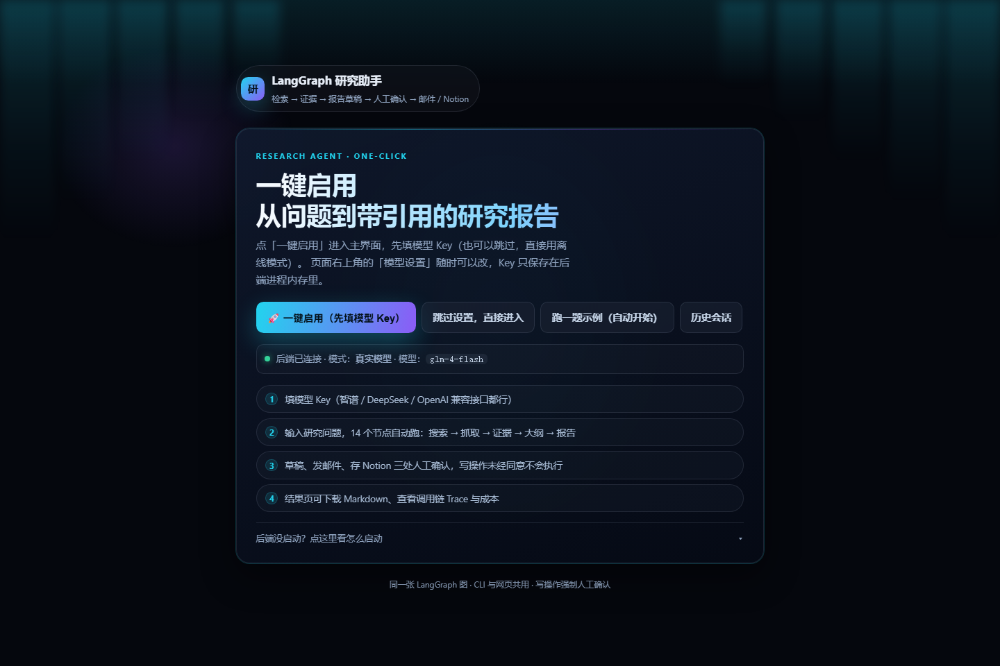

## 3 分钟跑起来

### 方式 A：网页版（推荐）

```bash
# 1) 装依赖（Python 3.11+）
python -m venv .venv
.venv\Scripts\activate            # Windows；macOS/Linux: source .venv/bin/activate
pip install -r requirements.txt

# 2) 一键启动（Windows：起后端 + 自动打开启动页）
start.bat
# 或者手动：
python web.py                     # 打开 http://127.0.0.1:8000
```

浏览器会打开**一键启用启动页**：点「🚀 一键启用」→ 进入主界面并**自动弹出模型设置**，
填 Key（或点「跳过设置，直接进入」用离线模式）→ 输入问题 → 开始研究。

### 方式 B：命令行

```bash
python main.py "LangGraph 如何实现人工中断？"          # 交互式三次人工确认
python main.py "LangGraph 如何实现人工中断？" --auto   # 演示/CI：自动批准
```

### 没有 LLM Key 也能跑

不配置 Key 时自动进入 `offline` 模式：启发式规划 + 逐句摘录证据 + 模板报告，
仍会**真实联网**搜索/抓取，引用同样可回溯。适合先看流程。

### 接入真实模型

复制模板并填 Key（`.env` 已 gitignore；也可以完全跳过 `.env`，在网页右上角「模型设置」里填）：

```bash
copy .env.example .env            # macOS/Linux: cp .env.example .env
```

| 服务 | `OPENAI_BASE_URL` | `OPENAI_MODEL` 示例 |
| --- | --- | --- |
| OpenAI 官方 | 留空（默认 `https://api.openai.com/v1`） | `gpt-4o-mini` |
| DeepSeek | `https://api.deepseek.com/v1` | `deepseek-chat` |
| 通义千问 | `https://dashscope.aliyuncs.com/compatible-mode/v1` | `qwen-plus` |
| 智谱 GLM | `https://open.bigmodel.cn/api/paas/v4` | `glm-4-flash` |
| 本地 Ollama | `http://127.0.0.1:11434/v1` | `qwen2.5:7b` |

```bash
python check_llm.py               # 真实调用一次，确认 Key/Base URL/模型可用
```

> 改 `.env` 后必须重启 `web.py`；网页里填的 Key 只存后端进程内存，重启失效、不回传明文。

## 界面与用法

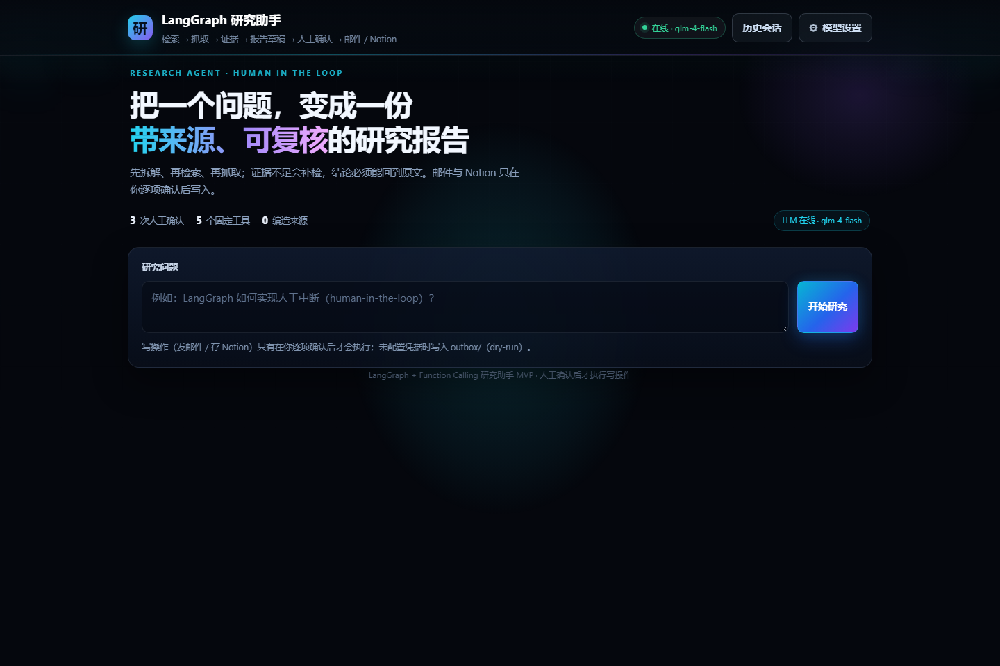

页面分两种形态：**首页**是搜索式入口（居中大标题 + 玻璃搜索台 + 四张能力卡）；
点「开始研究」或打开历史会话后自动切到**工作区**——首页内容收起，只留一条问题输入 + 流水线卡片，
「开始新的研究」会回到首页。

网页端一次研究的流程：

1. 输入问题 → **开始研究**（实时日志 + 14 段进度条）；
2. **草稿确认**：通过并继续 / 填修改意见重新生成 / 终止；
3. **邮件确认**：就地改收件人、主题 → 发送 或 跳过；
4. **Notion 确认**：就地改标题、标签 → 保存 或 跳过；
5. **最终结果**：报告（可下载 Markdown）、来源、证据表、写操作结果、错误与降级、完整日志。

**执行进度**：14 段节点格子逐个点亮 + 阶段表情/文案 + 百分比；「收起日志 / 展开日志」只折叠日志表，
进度条始终可见。补检回环只增不减，不会倒退。


**历史会话**：列表可「继续审批 / 查看 / 删除」；删除会同时清理该会话的 checkpoint。
执行中后端退出/断网时，进度**冻结标红**（`已中断 · 第 N/14 步`），并出现「会话未完成」卡片
（重新开始 / 删除），不会伪装成“完成”。

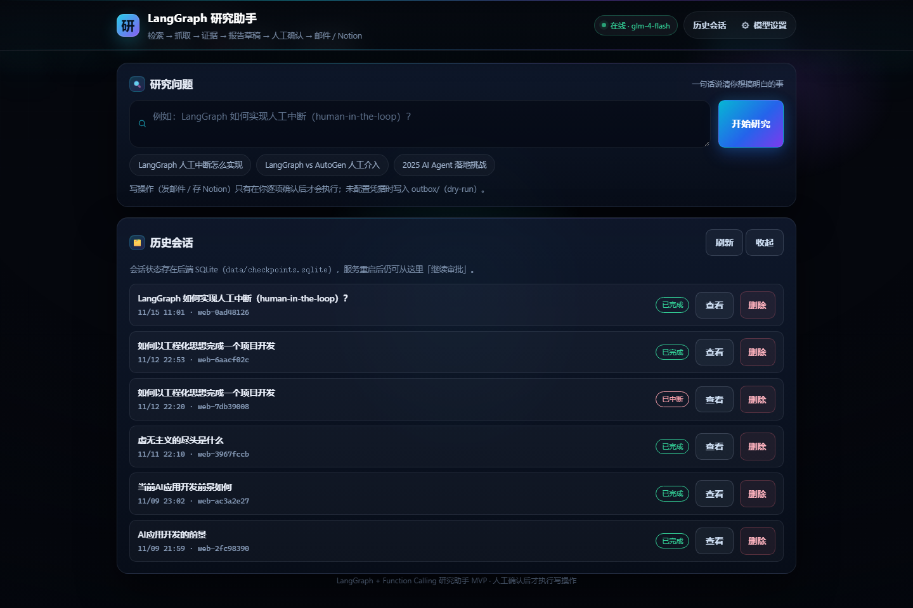

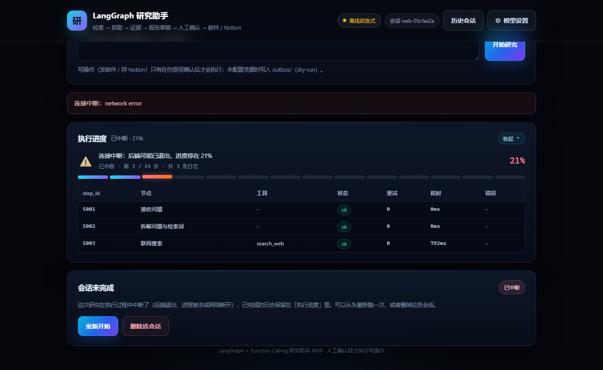

**报告阅读页**：终稿卡点「阅读报告页」或直接访问 `/report/<thread_id>`。三栏：目录 / 正文 / 证据。
正文里的 `[S#]` 可点，右侧高亮对应证据卡；点证据卡会反查正文并高亮引用处。左栏附带覆盖度、
引用校验与告警；支持字号 S/M/L（记住选择）、打印/导出 PDF（白底单栏）、复制链接、下载 Markdown。

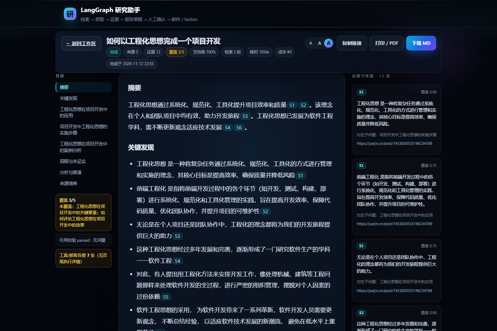

**多轮追问**：终稿卡或报告页点「继续追问」，输入框上方会出现「基于上一轮结论追问」提示，
新一轮会把上一轮结论摘要作为上下文注入（后端 `parent_thread_id`），历史列表里也能看到追问链。

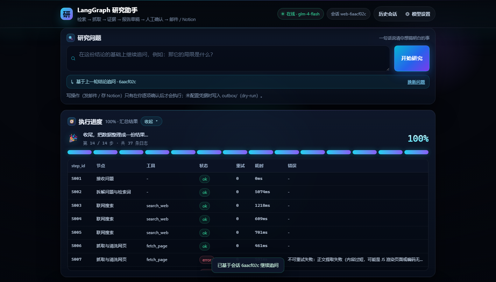

**取消运行**：15~30s 的研究过程中，进度卡右上角有「取消运行」。取消是协作式的——
只在**节点边界**生效（不会强杀线程、不会留下半写状态），界面会显示「已取消 · N%」而不是误报成连接中断。

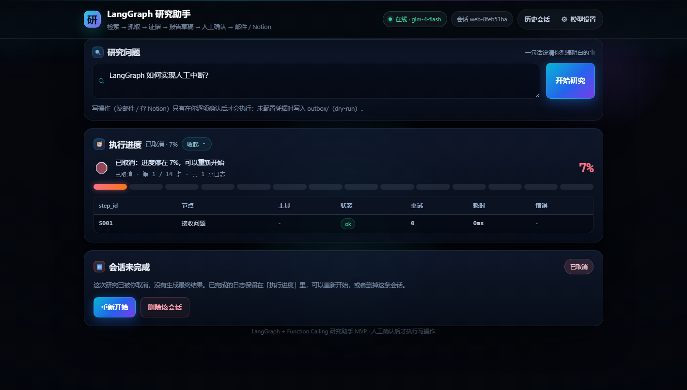

**历史检索**：历史会话支持按关键词（问题 / 会话号）搜索和按状态筛选。

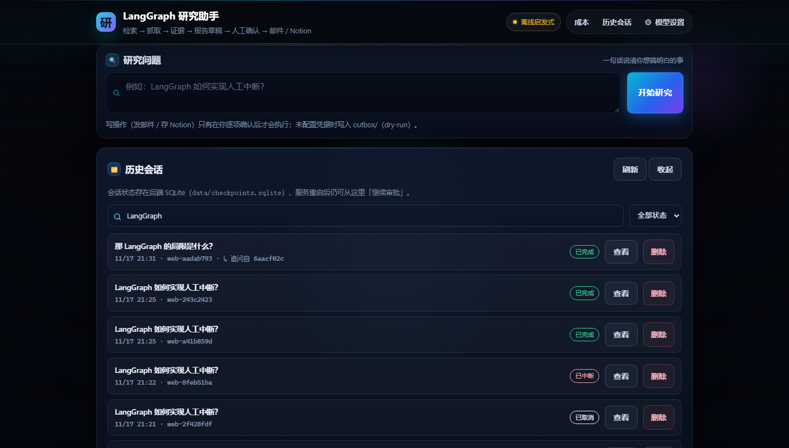

**成本看板**：右上角「成本」打开近 7/30 天的运行数、模型调用、token 与成本聚合（按模型 / 按天）。

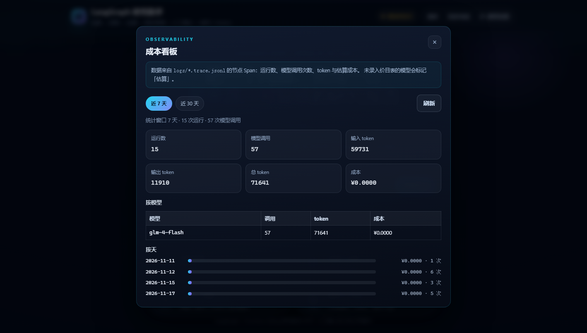

**导出 Word**：终稿卡与报告页都能「下载 Word」，导出的 `.docx` 含标题、指标、正文、表格与证据表附录。

**报告对比**：多轮追问生成的报告，可在报告页点「与上一轮对比」看正文增删（红绿差异，不含来源列表）。

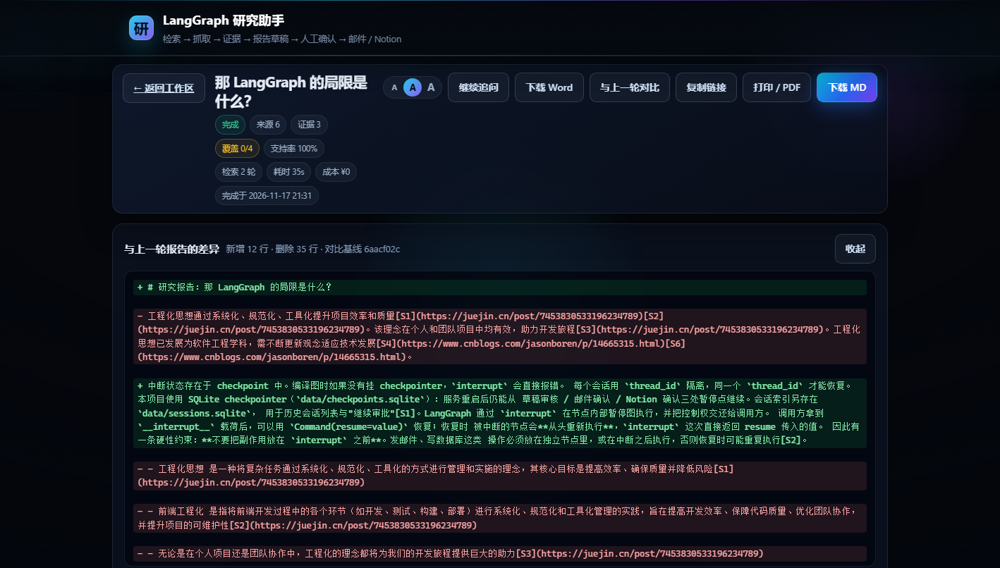

**知识库面板**：模型设置弹层里能看到知识库文档数/分块数/是否启用向量，并一键「重建索引」。

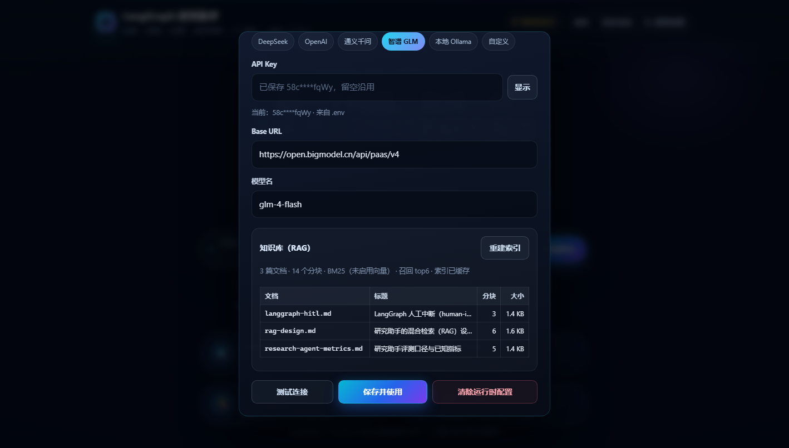

**鼠标聚光灯**：提问台、首页能力卡、流水线卡片和报告正文上，会跟着指针浮起一圈低透明度
青紫柔光（内层亮核 + 外层光晕），鼠标离开淡出。纯 CSS `radial-gradient` 画光斑，JS 只负责
用一次 `rAF` 把指针坐标写进 `--spot-x / --spot-y`；`pointer-events:none` 不挡文字与按钮，
触屏设备、「减少动态效果」和打印时自动关闭。

**模型设置**：提供方预设、Key 掩码显示、测试连接、保存到进程内存、清除运行时配置。


**深链参数**：`?settings=1` 打开设置、`?history=1` 打开历史、`?session=<thread_id>` 加载会话、
`?q=...&autostart=1` 自动开始；直接双击 `index.html`（`file://`）进入静态演示模式。

## 核心能力

| 能力 | 做了什么 |
| --- | --- |
| 研究质量闭环 | 子问题覆盖度 → 缺口补检（最多再 1 轮）→ 自适应抓取 → 内容指纹去重 → claim→quote 支持校验 |
| 报告质量闭环 | 证据卡片化（子问题/类型/营销标记/去重）→ 大纲分节 → 分节写作（摘要三段式 + 推演）→ 引用硬校验（重写更差则丢弃） |
| 人工审批与写门禁 | 3 次 `interrupt`；`human_approved=True` 只出现在 `execute_actions`；未确认直接 `WriteActionNotApproved` |
| 会话持久化与多轮 | SQLite checkpointer 断点恢复 + 会话索引；`parent_thread_id` 注入上一轮结论（≤1200 字） |
| 可观测 | 节点 Span（耗时/token/成本）、价目表最长前缀匹配、未知模型标「估算」、`/api/trace` 与成本汇总 |
| 知识库 RAG | 标题分块（800/120 重叠）→ BM25（中文 bigram）→ 可选向量 → RRF；无 Key 自动降级 BM25 |
| 性能 | 搜索/抓取 TTL 缓存（默认 24h）+ 并发抓取（默认 3，可设 1 退回串行）：同一问题二次运行实测 23.8s → 3.4s |
| 写操作可靠性 | 写操作审计表 + 幂等键：同一运行里重复执行不会重复发邮件/重复写 Notion；失败允许重试 |
| 交付物 | Markdown / Word（`.docx`）/ 打印 PDF / 报告阅读页 / 多轮报告 diff / 历史检索 / 成本看板 |

更细的实现记录见 [开发文档/OPTIMIZATION.md](开发文档/OPTIMIZATION.md)，
防编造/重试/编码/报告生成的细节见 [开发文档/质量与可靠性设计.md](开发文档/质量与可靠性设计.md)。

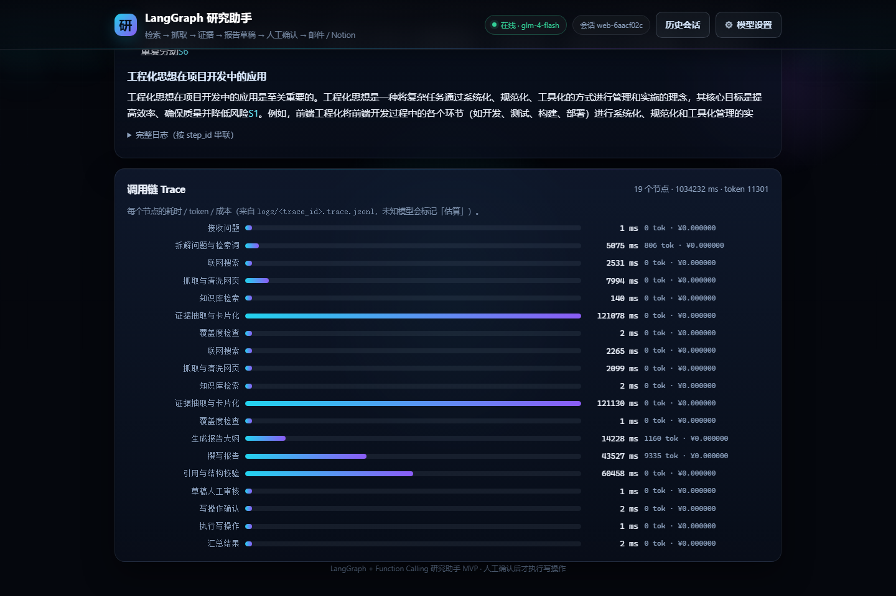

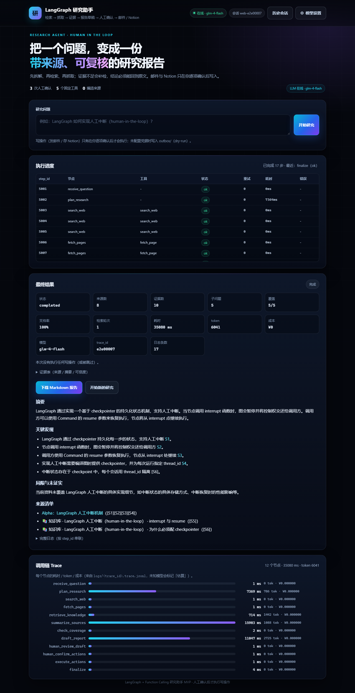

## 架构与流程

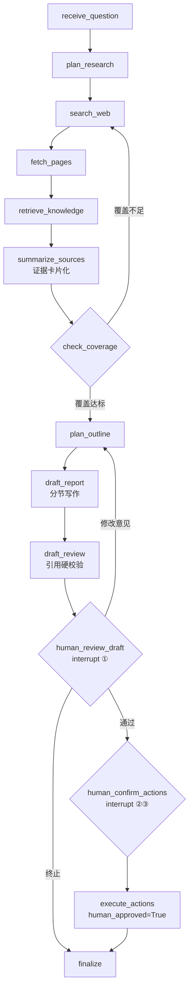

| # | 节点 | 作用 |
| --- | --- | --- |
| 1 | `receive_question` | 校验问题、记录 LLM 模式、token 基线 |
| 2 | `plan_research` | Function Calling/JSON/启发式生成 2~3 条 query + 3~5 个子问题 |
| 3 | `search_web` | 多提供方搜索（Bing/360/DDG/Wikipedia）、URL 去重、多轮合并 |
| 4 | `fetch_pages` | 自适应页数、候选重排、编码/正文清洗、URL + 内容指纹去重 |
| 5 | `retrieve_knowledge` | 知识库混合检索，命中转 `kb://` 来源 |
| 6 | `summarize_sources` | 提取证据 + claim 校验 + 证据卡片化 |
| 7 | `check_coverage` | 子问题覆盖度；不足时生成缺口 query（最多补 1 轮） |
| 8 | `plan_outline` | 按子问题排大纲并分配 `[S#]`；改稿先改大纲 |
| 9 | `draft_report` | 分节写作：摘要三段式、关键发现程序生成、推演带【推断】 |
| 10 | `draft_review` | 引用/结构硬校验 → 最小改动重写（更差则丢弃）→ 程序修复 |
| 11 | `human_review_draft` | **interrupt ①**：通过 / 修改 / 终止 |
| 12 | `human_confirm_actions` | **interrupt ②③**：发邮件前、存 Notion 前分别确认 |
| 13 | `execute_actions` | 只对已确认动作调用写工具 |
| 14 | `finalize` | 最终报告、来源、证据、覆盖率、token/成本/耗时、日志摘要 |

**关键机制**：

- 图编译时挂 `SqliteSaver`（`data/checkpoints.sqlite`），重启后同一 `thread_id` 可 `resume`；
- 两条条件回环：覆盖不足回搜索、草稿被修改回大纲；
- 写操作门禁统一在 `tools.call_tool()`，`execute_actions` 是唯一传 `human_approved=True` 的地方；
- 模型不可用时全链路降级（规划/证据/报告都有离线兜底），不会让图崩掉。

**目录结构**（细节见 [backend/README.md](backend/README.md)、[frontend/README.md](frontend/README.md)）：

```
.
├── graph.py / state.py / tools.py / llm_client.py / prompts.py …  # Agent 核心（14 节点）
├── web.py / index.html / launch.html / start.bat                  # 网页入口与启动
├── quality.py / reporting.py / rag.py / tracing.py / persistence.py
├── 原型图/ 开发文档/  frontend/ backend/ docs/                     # 截图 / 开发文档 / 代码索引
├── evaluation/ knowledge/ config/ data/ logs/ outbox/             # 评测 / 知识库 / 配置 / 运行产物
└── tests/                                                          # 23 文件 / 166 用例
```

## 评测数据

真实联网 40 题（`real_p0`，离线 LLM + 真实检索）：

| 指标 | 结果 |
| --- | --- |
| 任务成功率 | **85.0%**（多跳 70.0%、对比 70.0%） |
| 引用可追溯 / 可点击 | **100% / 100%** |
| 工具调用正确率 | 90.0% |
| 子问题证据覆盖率 | 51.2% |
| 证据断言支持率 | 99.4%（规则代理） |
| 平均检索轮次 | 1.68 |
| 平均 / P95 延迟 | 15.6s / 26.7s |

mock 流水线基线：成功率 100%、覆盖率 90%、支持率 100%、延迟 21ms。

> **口径说明**：以上是“离线启发式 LLM + 真实联网”的结果，token/成本为 0，不代表真实模型写作质量。
> 完整表格、失败案例、消融与指标定义见 [开发文档/评测方法.md](开发文档/评测方法.md) 与
> [开发文档/eval_report.md](开发文档/eval_report.md)。

## 环境变量

复制 `.env.example` 为 `.env` 后按需修改；网页「模型设置」可覆盖 Key/Base/模型（仅进程内存）。

| 常用变量 | 说明 |
| --- | --- |
| `OPENAI_API_KEY` / `OPENAI_BASE_URL` / `OPENAI_MODEL` | 模型接入；Key 留空进入离线模式 |
| `AGENT_LLM_MODE` | `auto`（默认）/ `openai` / `offline` |
| `AGENT_WEB_PORT` | 网页端口，默认 `8000` |
| `AGENT_CHECKPOINT_DB` / `AGENT_SESSIONS_DB` | 默认 `data/checkpoints.sqlite` / `data/sessions.sqlite` |
| `AGENT_KB_DIR` / `AGENT_KB_INDEX` | 知识库目录（默认 `knowledge/`）/ 索引缓存（`data/kb_index.json`） |
| `AGENT_LOG_DIR` / `AGENT_TRACE_DIR` | 日志与 trace 目录，默认 `logs` |
| `AGENT_OUTBOX_DIR` | dry-run 输出目录，默认 `outbox` |
| `AGENT_CACHE_ENABLED` / `AGENT_CACHE_TTL` | 搜索/抓取缓存开关（默认 1）/ TTL 秒数（默认 86400） |
| `AGENT_FETCH_CONCURRENCY` | 并发抓取数，默认 3；设 1 完全退回串行 |
| `AGENT_WRITE_IDEMPOTENT` / `AGENT_WRITE_AUDIT_DB` | 写操作幂等开关（默认 1）/ 审计库路径（默认 `data/write_audit.sqlite`） |

<details>
<summary>完整环境变量表（点击展开）</summary>

| 变量 | 说明 |
| --- | --- |
| `OPENAI_API_KEY` | OpenAI 或兼容服务 Key；留空自动离线 |
| `OPENAI_BASE_URL` | 兼容 OpenAI 的网关地址，可留空 |
| `OPENAI_MODEL` | 模型名，默认 `gpt-4o-mini` |
| `AGENT_LLM_MODE` | `auto` / `openai` / `offline` |
| `AGENT_MAX_PAGES` / `AGENT_MAX_PAGES_HARD` | 基础抓取页数 3 / 自适应硬上限 6 |
| `AGENT_MAX_RETRIEVAL_ROUNDS` | 总检索轮次上限，默认 2 |
| `AGENT_COVERAGE_MIN` / `AGENT_COVERAGE_THRESHOLD` | 触发补检 0.75 / 单子问题覆盖阈值 0.6 |
| `AGENT_MAX_GAP_QUERIES` | 一次补检最多几条 query，默认 2 |
| `AGENT_EVIDENCE_MAX` / `AGENT_EVIDENCE_PER_SOURCE` | 离线证据总条数/每来源条数，16 / 3 |
| `AGENT_TOOL_MAX_ATTEMPTS` / `AGENT_RETRY_BASE_DELAY` | 重试次数 3 / 退避基数 0.5s |
| `AGENT_SEARCH_PROVIDERS` | 搜索提供方顺序，默认 `bing,so360,duckduckgo,wikipedia` |
| `AGENT_SEARCH_TIMEOUT` / `AGENT_FETCH_TIMEOUT` / `AGENT_SUMMARIZE_TIMEOUT` | 单次工具预算 20 / 15 / 25s |
| `AGENT_SEARCH_NODE_BUDGET` / `AGENT_FETCH_NODE_BUDGET` | 节点时间预算 40 / 45s |
| `AGENT_FETCH_MAX_ATTEMPTS` | 抓取阶段最多尝试 URL 数，默认 8（成功 3 个即止） |
| `AGENT_PROVIDER_FAILURE_LIMIT` | 提供方连续失败几次后跳过，默认 2 |
| `AGENT_MOJIBAKE_RATIO` | 乱码段落丢弃阈值，默认 0.3 |
| `AGENT_LLM_TIMEOUT` | 单次 LLM 请求超时，默认 30s |
| `AGENT_PRICE_INPUT_PER_MTOK` / `AGENT_PRICE_OUTPUT_PER_MTOK` | token 单价（元/百万），1.0 / 4.0 |
| `AGENT_LINK_CITATIONS` | `[S#]` 是否可点击，默认 1；0 用于消融 |
| `AGENT_PLAN_SUB_QUESTIONS` | 是否生成子问题，默认 1；0 用于消融 |
| `DEFAULT_EMAIL_TO` | 邮件默认收件人 |
| `SMTP_HOST/PORT/USER/PASSWORD/FROM` | 配置后真实发信，否则 dry-run 落盘 |
| `NOTION_TOKEN` + `NOTION_PAGE_ID`/`NOTION_DATABASE_ID` | 配置后真实写 Notion，否则 dry-run |
| `AGENT_OUTBOX_DIR` | dry-run 输出目录，默认 `outbox` |
| `AGENT_LOG_DIR` | JSONL 日志目录，默认 `logs` |
| `AGENT_AUTO_APPROVE` | `1` 时自动批准（仅演示/CI） |
| `AGENT_WEB_PORT` | 网页端口，默认 `8000` |
| `AGENT_CHECKPOINT_DB` / `AGENT_SESSIONS_DB` | SQLite 路径（断点恢复 / 历史列表） |
| `AGENT_TRACE_DIR` | Span 落盘目录，默认跟随 `AGENT_LOG_DIR` |
| `AGENT_KB_DIR` / `AGENT_KB_INDEX` / `AGENT_KB_TOP_K` | 知识库目录 / 索引缓存 / 返回片段数 6 |
| `AGENT_KB_CHUNK_SIZE` / `AGENT_KB_OVERLAP` | 分块 800 / 重叠 120 |
| `AGENT_EMBEDDING_MODEL` | embedding 模型，默认 `text-embedding-3-small`；失败降级 BM25 |
| `AGENT_EVIDENCE_CARDS` / `AGENT_EVIDENCE_CARDS_MAX` | 证据卡片化开关 / 上限 20 |
| `AGENT_DRAFT_SECTIONS_MAX` / `AGENT_DRAFT_REVIEW` / `AGENT_DRAFT_MAX_REWRITE` | 分节数 3 / 校验开关 / 重写次数 1 |
| `AGENT_CACHE_ENABLED` / `AGENT_CACHE_TTL` / `AGENT_CACHE_DB` | 缓存开关 1 / TTL 86400s / `data/cache.sqlite` |
| `AGENT_FETCH_CONCURRENCY` | 并发抓取数，默认 3（夹取 1~6） |
| `AGENT_WRITE_IDEMPOTENT` / `AGENT_WRITE_AUDIT_DB` | 写操作幂等 1 / `data/write_audit.sqlite` |

</details>

密钥优先级：**网页「模型设置」（进程内存）→ `.env` → 离线模式**；代码里没有硬编码 Key。

## 接口

<details>
<summary>完整接口表（点击展开）</summary>

| 接口 | 说明 |
| --- | --- |
| `POST /api/research` | 启动一次研究，返回第一次中断或最终结果（可带 `parent_thread_id`） |
| `POST /api/resume` | 提交人工确认，返回下一次中断或最终结果 |
| `POST /api/research/stream` / `POST /api/resume/stream` | 同上，NDJSON 流式：`start` → `log`… → `result` / `error` / `cancelled` |
| `GET /api/sessions?limit=20&q=&status=` | 历史会话列表（关键词匹配问题/会话号，可按状态筛选） |
| `GET /api/sessions/{thread_id}` | 加载单个会话（含中断载荷、`parent_thread_id`） |
| `DELETE /api/sessions/{thread_id}` | 删除会话（索引 + 该 thread 的 checkpoint/writes） |
| `POST /api/sessions/{thread_id}/interrupt` | 把 `running` 会话标成 `interrupted` |
| `POST /api/sessions/{thread_id}/cancel` | 请求取消运行（协作式：下一个节点边界生效） |
| `GET /api/sessions/{thread_id}/diff` | 本轮报告与上一轮（parent）的正文差异 |
| `GET /api/sessions/{thread_id}/export.docx` | 导出 Word（未装 `python-docx` 时 503） |
| `GET /api/kb` / `POST /api/kb/reindex` | 知识库统计与文档列表 / 删除索引缓存并重建 |
| `GET /api/health` | 健康检查、LLM 模式/模型、持久化方式 |
| `GET /api/trace/{trace_id}` | 节点级调用链：耗时 / token / 成本 / 错误 |
| `GET /api/cost/summary?days=7` | 按天/按模型聚合成本 |
| `GET/POST/DELETE /api/config`、`POST /api/config/test` | 模型配置（掩码、测试连接、清除） |
| 页面路由 | `/` 启动页、`/launch` 启动页、`/index.html` 主界面、`/app` 主界面、`/report/<thread_id>` 报告阅读页 |

> 流式终态：正常完成推 `result`，后端异常推 `error`，用户取消推 `cancelled`（会话状态记为 `cancelled`）。

</details>

请求/响应字段、流式事件结构、人工确认载荷与错误码见 **[开发文档/接口文档.md](开发文档/接口文档.md)**；
数据库表结构见 [开发文档/数据库设计文档.md](开发文档/数据库设计文档.md)。

## 测试与验收

```bash
pytest -q                              # 226 passed
python evaluation/acceptance_check.py  # 9/9（生成 FUNCTIONAL_ACCEPTANCE.md）
python evaluation/kb_check.py          # 6/6（只给 knowledge/、不联网）
```

测试分层、验收对照表与夹具说明见 [开发文档/测试与验收.md](开发文档/测试与验收.md)。

## 目录与文档

| 位置 | 内容 |
| --- | --- |
| [原型图/](原型图/) | 22 张页面原型/界面截图（含索引） |
| [开发文档/](开发文档/) | 接口文档、数据库设计、质量与可靠性设计、测试与验收、评测方法、优化记录、验收/评测报告 |
| [frontend/](frontend/) · [backend/](backend/) | 前端/后端代码索引（代码仍在根目录） |
| [tests/](tests/) | 36 个测试文件 / 226 用例 |
| [PROJECT_SUMMARY.md](PROJECT_SUMMARY.md) | 项目快照（架构、能力矩阵、限制） |
| [docs/](docs/) | 已迁移，仅指向 原型图/ |

## 已知限制

- **单机原型**：SQLite 单写者，多实例需换 `PostgresSaver`；无鉴权/限流，只监听 `127.0.0.1`。
- **写操作默认 dry-run**：未配置 SMTP/Notion 时只落盘 `.eml` / `.md`。
- **检索质量是瓶颈**：真实评测子问题覆盖率 51.2%，主要卡在对比题只抓到一方、站点 403/JS 空页。
- **规则代理指标**：覆盖率/支持率是词面与规则判断，不是语义蕴含，不能替代人工抽检。
- **延迟**：首次单题约 15~30s（真实联网）；同一问题二次运行命中缓存可降到 ~3s。
- **取消是协作式的**：只在节点边界生效（当前节点若在 HTTP 预算内，最迟约 15~20s 停下），不强杀线程。
- **中断后只能重跑**：checkpoint 只保证人工审批点可恢复；进程在普通节点执行中被杀只能重跑或删除会话。
- **真实 LLM 未全量评测**：40 题仍是离线 LLM + 真实联网；`glm-4-flash` 等免费模型成本真实为 0。
- **知识库规模**：纯 Python 余弦，约 1 万 chunk 上限；embedding 需服务支持 `/embeddings`。
- **Word 导出依赖可选包**：需要 `python-docx`（已写进 `requirements.txt`）；未安装时导出接口返回 503，其它功能不受影响。
- **缓存/审计是运行产物**：`data/cache.sqlite`、`data/write_audit.sqlite` 会随使用增长，长期运行需要清理策略。
- **报告 diff 只看正文**：不比较来源清单，且最多返回 200 行差异（超出会标记截断）。

完整清单见 [PROJECT_SUMMARY.md](PROJECT_SUMMARY.md) §9。

## 常见问题

**Q：`ModuleNotFoundError: No module named 'fastapi'`**
运行 `web.py` 的解释器不是项目 `.venv`。`web.py` 会自动尝试切到 `.venv`；手动方式：
`.\.venv\Scripts\python.exe web.py`。

**Q：页面一直显示「正在检索、抓取并总结证据…」**
流式接口每完成一步就会出现一行日志。若 20 秒内一行都没有，检查终端里 uvicorn 是否还在、
端口是否被占用；可用 `AGENT_SEARCH_TIMEOUT` / `AGENT_FETCH_NODE_BUDGET` 收紧预算。

**Q：改了代码/配置但页面没变化**
`uvicorn` 不是热重载，改 `web.py` 或 `.env` 后要重启；浏览器再 `Ctrl+F5` 强刷。

**Q：模型设置里保存了 Key，重启后又没了**
设计如此：Key 只存后端进程内存，不写 `.env`、不存浏览器；需要持久化请写 `.env`。

**Q：Windows 终端中文乱码**
先执行 `chcp 65001` 再运行。

---

> 文档分工：本 README 面向“快速了解与上手”；开发细节在 [开发文档/](开发文档/)；
> 项目全貌在 [PROJECT_SUMMARY.md](PROJECT_SUMMARY.md)。
