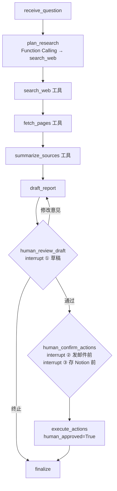
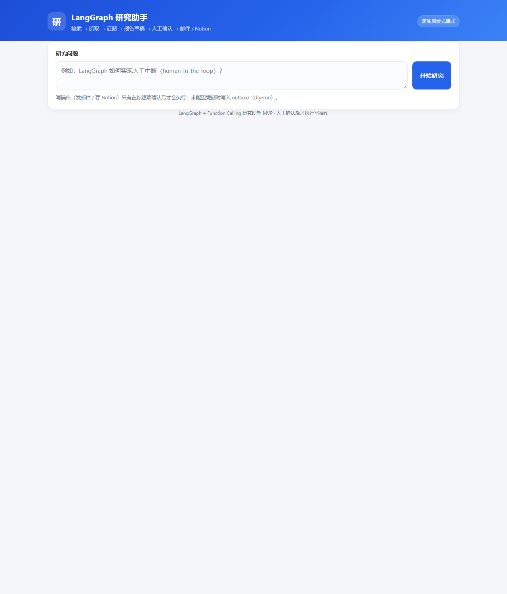

# LangGraph 研究助手（Research Assistant MVP）

一个**只做研究助手窄场景**的 Agent：接收研究问题 → 规划检索 → 搜索网页 → 抓取正文 →
总结证据 → 生成报告草稿 → **人工确认** → 写邮件 / 存 Notion → 输出最终结果。

技术栈：Python + LangGraph（`StateGraph` + `interrupt` + checkpointer）+ Function Calling
（OpenAI / 兼容 OpenAI 的服务）。同一个 Agent 有两种入口：命令行 `main.py` 与网页版
`web.py`（FastAPI + 单页 HTML），两者共用同一张图、同一套工具与写操作门禁。

> 设计目标：可运行的 MVP，而不是通用 Agent 框架。工具固定 5 个，写操作必须人工确认。

---

## 1. 工作流



- **三处 `interrupt()`**：草稿审核、发邮件前、存 Notion 前。后两处都在 `human_confirm_actions`
  节点内顺序执行，各自产生一次独立的暂停/恢复，因此邮件与 Notion 可以分别同意或拒绝。
- 图编译时挂 `InMemorySaver` checkpointer，`invoke` 返回 `__interrupt__`，
  `main.py` 收集人工输入后用 `Command(resume=...)` 恢复。
- 草稿审核支持「通过 / 修改（重新生成，最多 2 轮）/ 终止」。
- 只有 `execute_actions` 会以 `human_approved=True` 调用写工具，且仅针对人工同意的动作。

### 检索规划：技术搜索专家

`plan_research` 先做**问题拆解**（3~5 个可独立检索的子问题），再用 `prompts.PLAN_SYSTEM` 的「技术搜索专家」规则转成 2~3 个关键词组合：

- **How 类问题**（如何实现 / 原理 / 教程）强制加入技术词：「代码示例」「tutorial」「documentation」「implementation」；
- **命中框架**（LangGraph / FastAPI / React 等）时加入官方文档限定词，如 `site:langchain.com`、`site:fastapi.tiangolo.com`、`site:github.com`；
- **去掉口语化表达**（「我想知道」「怎么弄」「请问」「帮我」）；
- 优先用 **Function Calling** 提交 `search_web` 调用；网关不支持 tools 时回退到 **JSON 数组输出**（`PLAN_JSON_SYSTEM`，输出 `["搜索词1", "搜索词2"]`）。

离线模式（无 Key）由 `LLMClient._heuristic_plan()` 在本地按同一套规则生成关键词，并做去重与 2~3 条上限；`heuristic_sub_questions()` 生成 4 个子问题。

## 2. 文件结构

```
.
├── graph.py             # LangGraph 图：10 个节点 + 条件边 + interrupt + checkpointer
├── state.py             # ResearchState TypedDict + 初始状态
├── tools.py             # 5 个工具、JSON Schema、重试装饰逻辑、写操作门禁
├── text_clean.py        # 网页编码探测（charset_normalizer）+ 乱码段落清洗
├── prompts.py           # 全部提示词
├── logging_utils.py     # 结构化日志（state + JSONL）
├── human_review.py      # 命令行人工确认（草稿 / 写操作参数）
├── llm_client.py        # OpenAI Function Calling 客户端 + 离线启发式回退
├── main.py              # 命令行入口（中断-恢复循环）
├── check_llm.py         # 真实大模型接入自检（读 .env + 真实调用一次）
├── web.py               # 网页版入口（FastAPI，复用同一张图与同一套门禁）
├── index.html           # 单页前端（可直接双击演示；由 web.py 托管时连真实后端）
├── evaluation/          # 40 题评测集 + 跑分脚本 + eval_report.md
│   ├── dataset.jsonl    # 测试集（简单事实 / 对比 / 时效 / 多跳，各 10 题）
│   ├── run_eval.py      # 逐题跑图并统计指标
│   ├── mock_web.py      # 确定性 fixture（仅测流水线机制）
│   ├── make_report.py   # 汇总 evaluation/eval_report.md
│   ├── acceptance_check.py # 9 项功能闭环验收，生成 FUNCTIONAL_ACCEPTANCE.md
│   ├── eval_report.md   # 评测报告（自动生成）
│   └── results/         # 每次评测的 JSONL / summary / 人工抽样
├── FUNCTIONAL_ACCEPTANCE.md # 功能验收报告（自动生成）
├── requirements.txt
├── pytest.ini
├── .env.example
└── tests/
    ├── conftest.py
    ├── test_graph_flow.py        # 端到端：三次中断、确认前不写、日志链路、无来源降级
    ├── test_tools_retry.py       # 重试 3 次 + 指数退避 + 耗尽后结构化失败
    ├── test_tools_safety.py      # SSRF：内网 IP / 解析到内网的域名一律拒绝
    ├── test_web_api.py           # Web API：首页、三次中断、确认前零写入
    ├── test_write_guard.py       # 未确认写操作被拒绝 / 参数无法伪造 human_approved
    ├── test_evidence_integrity.py# 编造 URL、改写引文被过滤；报告 URL 白名单清洗
    ├── test_encoding.py          # GBK/UTF-16 探测、乱码段落丢弃、整页乱码确定性失败
    ├── test_draft_template.py    # 三段式报告、[S#] 引用、可点击化、来源清单重建
    └── test_planning.py          # 检索规划、3~5 个子问题、JSON 解析
```

## 3. 安装

```bash
python -m venv .venv
# Windows
.venv\Scripts\activate
# macOS / Linux
source .venv/bin/activate

pip install -r requirements.txt
```

## 4. 环境变量

复制 `.env.example` 为 `.env`：

```bash
cp .env.example .env        # Windows: copy .env.example .env
```

| 变量 | 说明 |
| --- | --- |
| `OPENAI_API_KEY` | OpenAI 或兼容服务的 Key；**留空则自动进入离线启发式模式** |
| `OPENAI_BASE_URL` | 兼容 OpenAI 的网关地址，可留空 |
| `OPENAI_MODEL` | 模型名，默认 `gpt-4o-mini` |
| `AGENT_LLM_MODE` | `auto`（默认）/ `openai` / `offline` |
| `AGENT_MAX_PAGES` | 最多抓取页面数，默认 3 |
| `AGENT_TOOL_MAX_ATTEMPTS` | 工具最大尝试次数，默认 3 |
| `AGENT_RETRY_BASE_DELAY` | 指数退避基数，默认 0.5 秒（0.5 → 1 → 2 …） |
| `AGENT_SEARCH_PROVIDERS` | 搜索提供方顺序，默认 `bing,so360,duckduckgo,wikipedia`；中文宽泛问题自动把 360 提前 |
| `AGENT_SEARCH_TIMEOUT` / `AGENT_FETCH_TIMEOUT` / `AGENT_SUMMARIZE_TIMEOUT` | 单次工具时间预算（秒），默认 20 / 15 / 25；超预算停止重试 |
| `AGENT_SEARCH_NODE_BUDGET` / `AGENT_FETCH_NODE_BUDGET` | 整个节点时间预算（秒），默认 40 / 45 |
| `AGENT_FETCH_MAX_ATTEMPTS` | 抓取阶段最多尝试多少个 URL，默认 8（成功 3 个即止） |
| `AGENT_PROVIDER_FAILURE_LIMIT` | 某搜索提供方连续失败几次后在本进程内跳过，默认 2 |
| `AGENT_MOJIBAKE_RATIO` | 乱码段落丢弃阈值：可疑字符占比超过该值即丢弃，默认 `0.3` |
| `AGENT_LLM_TIMEOUT` | 单次 LLM 请求超时（秒），默认 30 |
| `AGENT_PRICE_INPUT_PER_MTOK` / `AGENT_PRICE_OUTPUT_PER_MTOK` | token 成本单价（元/百万 token），默认 1.0 / 4.0，用于 `final_output.cost_cny` |
| `AGENT_LINK_CITATIONS` | `1`（默认）把报告里的 `[S#]` 变成可点击来源；`0` 用于评测消融 |
| `AGENT_PLAN_SUB_QUESTIONS` | `1`（默认）生成 3~5 个子问题；`0` 用于评测消融 |
| `DEFAULT_EMAIL_TO` | 草稿确认后邮件收件人默认值 |
| `SMTP_HOST/PORT/USER/PASSWORD/FROM` | 配置后真实发信；不配置则写入 `outbox/emails/`（dry-run） |
| `NOTION_TOKEN` + `NOTION_PAGE_ID`/`NOTION_DATABASE_ID` | 配置后真实写入 Notion；否则写入 `outbox/notion/`（dry-run） |
| `AGENT_OUTBOX_DIR` | dry-run 输出目录，默认 `outbox` |
| `AGENT_LOG_DIR` | JSONL 日志目录，默认 `logs` |
| `AGENT_AUTO_APPROVE` | `1` 时跳过交互自动批准（仅演示/CI） |
| `AGENT_WEB_PORT` | 网页版端口，默认 `8000` |

密钥只从 `.env` 读取，代码里没有硬编码。

### 4.1 接入真实大模型（OpenAI / 国内兼容接口 / 本地）

目前默认跑离线启发式；接入真实模型只需要三步：

**① 创建 `.env` 并填 Key**（`.env` 已在 `.gitignore` 里，不会进仓库；**不要把 Key 填进 `.env.example`，它只是模板，程序不会读取**）：

```bash
copy .env.example .env        # Windows
# cp .env.example .env       # macOS / Linux
```

```ini
OPENAI_API_KEY=sk-你的Key
OPENAI_BASE_URL=            # OpenAI 官方可留空；兼容网关填到 /v1
OPENAI_MODEL=gpt-4o-mini
AGENT_LLM_MODE=auto         # auto：有 Key 用真实模型，没有则离线
```

**② 按服务商填写 Base URL / 模型名**（都走 OpenAI 兼容协议）：

| 服务 | `OPENAI_BASE_URL` | `OPENAI_MODEL` 示例 |
| --- | --- | --- |
| OpenAI 官方 | 留空（默认 `https://api.openai.com/v1`） | `gpt-4o-mini` / `gpt-4.1-mini` |
| DeepSeek | `https://api.deepseek.com/v1` | `deepseek-chat` |
| 通义千问（DashScope 兼容模式） | `https://dashscope.aliyuncs.com/compatible-mode/v1` | `qwen-plus` |
| 智谱 GLM | `https://open.bigmodel.cn/api/paas/v4` | `glm-4-flash` |
| 本地 Ollama | `http://127.0.0.1:11434/v1` | `qwen2.5:7b`（Key 随便填一个非空值） |

**③ 自检并重启**：

```bash
python check_llm.py          # 读取 .env，真实调用一次模型，打印 provider / token / 耗时
python web.py                # 重新启动网页版（改 .env 后必须重启）
```

自检成功会打印「已连接到真实模型」；如果仍是「离线模式」，按提示检查 Key / Base URL（常见问题：Base URL 忘了 `/v1`、Key 复制带了空格、超时时间太短）。

**如果 `check_llm.py` 显示 `.env 文件: 存在`，但 `API Key: （空）`、模型是 `gpt-4o-mini`**：说明当前终端用的是没装 `python-dotenv` 的系统 Python（`.env` 根本没被加载）。新版 `check_llm.py` 会自动切换到项目 `.venv`；也可以显式用：

```bash
.venv\Scripts\python.exe check_llm.py     # Windows
.venv/bin/python check_llm.py             # macOS / Linux
```

重新填 Key / Base URL / 模型也可以直接命令写入（Key 输入不回显）：

```bash
python check_llm.py --set-key --base-url https://api.deepseek.com/v1 --model deepseek-chat
```

接入后哪些环节会变化：

- `plan_research` 走 **Function Calling**（网关不支持 tools 时自动回退 JSON 规划）；
- `summarize_sources` 由模型按「严谨研究助理」规则提取证据，`filter_evidence` 继续逐字校验；
- `draft_report` 由模型生成三段式报告，`_sanitize_report` 继续做 URL 白名单与引用清洗；
- 模型报错/超时会自动降级到离线启发式，不会让整张图崩掉；
- `final_output.token_usage / cost_cny` 变成真实值（按 `AGENT_PRICE_INPUT_PER_MTOK` / `AGENT_PRICE_OUTPUT_PER_MTOK` 估算，人民币）。

建议接入后的下一步：

```bash
python check_llm.py
python evaluation/run_eval.py --mode real --llm openai --tag real_llm --limit 10   # 先跑 10 题看质量/成本
python evaluation/run_eval.py --mode real --llm openai --tag real_llm              # 全量 40 题
python evaluation/make_report.py                                                    # 更新 eval_report.md
```

## 5. 运行

### 5.1 交互模式（推荐）

```bash
python main.py "LangGraph 如何实现人工中断（human-in-the-loop）？"
```

流程中会先后暂停三次：

1. 打印报告草稿，选择 `[1] 通过 / [2] 修改意见 / [3] 终止`；
2. 打印邮件收件人、主题、正文预览，确认是否发送，并可就地修改收件人/主题；
3. 打印 Notion 标题、标签、内容预览，确认是否保存，并可就地修改标题/标签。

### 5.2 自动模式（演示 / CI）

```bash
python main.py "你的研究问题" --auto
```

自动批准草稿与两项写操作，便于一次跑完看最终输出；**不会绕过工具层的 `human_approved` 校验**。

### 5.3 没有 LLM Key 也能跑

不配置 `OPENAI_API_KEY` 时自动进入 `offline` 模式：

- 检索计划：关键词启发式；
- 证据总结：**逐句摘录抓取到的正文**（不调用模型，不改写）；
- 报告草稿：模板生成，事实全部来自摘录，并标注来源 URL。

离线模式仍会真实调用 `search_web` / `fetch_page`：

- 搜索默认按 `Bing → 360 → DuckDuckGo → Wikipedia` 顺序尝试，任一可用即可；中文宽泛问题会自动把
  360（so.com）提前（Bing 对「2025 年 AI Agent 企业落地」这类问题常返回统计公报/百科等不相关结果），
  命中 LangGraph 等具体技术词时仍优先 Bing（官方文档更全）；可用 `AGENT_SEARCH_PROVIDERS` 调整顺序或删减；
- 抓取到的页面 URL 是真实来源，报告中的引用均可回溯。

若要完整的模型写作与真实 Function Calling，填 `OPENAI_API_KEY` 即可。

### 5.4 输出

- 终端：最终报告、写操作结果、错误与降级记录、按 `step_id` 排序的日志表；
- `logs/research-<trace_id>.jsonl`：完整结构化日志；
- `outbox/emails/*.eml`、`outbox/notion/*.md`：未配置 SMTP/Notion 时的 dry-run 产物。

> Windows 终端若出现中文乱码，先执行 `chcp 65001` 再运行。

### 5.5 网页版（浏览器）

```bash
python web.py
# 或
uvicorn web:app --host 127.0.0.1 --port 8000
```

页面文件是项目根目录的 `index.html`，有两种用法：

- **连真实后端**：先 `python web.py`，再访问 <http://127.0.0.1:8000>；
- **纯静态演示**：直接双击 `index.html`（`file://`）→ 页面自动进入「静态演示模式」，
  用内置示例数据走完「草稿 → 邮件 → Notion」三次确认，不需要后端；页面顶部会明确标注
  「静态演示模式：数据是示例，未连接后端」。也可以带参数直接看演示：
  `index.html?q=你的研究问题&autostart=1`。


打开 <http://127.0.0.1:8000> 后的真实流程：



1. 输入研究问题 → **开始研究**（页面实时显示结构化日志与进度）；
2. **草稿确认**：通过并继续 / 填写修改意见重新生成 / 终止流程；
3. **邮件确认**：可就地修改收件人、主题 → 确认发送 或 跳过；
4. **Notion 确认**：可就地修改标题、标签 → 确认保存 或 跳过；
5. **最终结果**：状态、写操作结果、错误与降级、完整报告（可下载 Markdown）、完整日志表。

网页与 CLI 共用同一张 LangGraph 图、同一套工具和写操作门禁，后端接口：

| 接口 | 说明 |
| --- | --- |
| `POST /api/research` `{"question": "..."}` | 启动一次研究，返回第一次中断或最终结果 |
| `POST /api/resume` `{"thread_id": "...", "value": {...}}` | 提交人工确认，返回下一次中断或最终结果 |
| `POST /api/research/stream` / `POST /api/resume/stream` | 同上，但用 NDJSON **实时推送日志**，最后一行是 `result` 或 `error` |
| `GET /api/health` | 健康检查与当前 LLM 模式 |

网页默认走流式接口：搜索、抓取每完成一步，进度表就会实时出现一行日志，不会整段“看起来卡住”。

会话按 `thread_id` 存在 `InMemorySaver` 中，进程重启后未完成会话会丢失；默认只监听
`127.0.0.1`，没有鉴权，不要直接暴露到公网。

### 5.6 常见问题：`ModuleNotFoundError: No module named 'fastapi'`

原因：运行 `web.py` 的 Python 解释器不是项目虚拟环境。例如从根目录 `D:\Build` 的 uv 环境
（`D:\Build\.venv`，其 `pyproject.toml` 里 `dependencies = []`）去跑本项目的文件，该环境里
没有 fastapi / langgraph。

现在 `web.py` 会自动检测：缺依赖时优先切换到项目自带的 `.venv` 再启动，并打印提示。手动方式：

```powershell
cd D:\Build\AI-hy
.\.venv\Scripts\python.exe web.py
```

或者给当前解释器安装依赖：

```powershell
D:\Build\.venv\Scripts\python.exe -m pip install -r D:\Build\AI-hy\requirements.txt
```

### 5.7 常见问题：页面一直显示「正在检索、抓取并总结证据…」

- 网页版走的是流式接口，**每一步完成就会在「执行进度」里出现一行日志**，并显示已完成的步数与耗时；
  如果 20 秒内一行都没有，说明请求还没到后端或服务已退出，看终端里 uvicorn 是否还在。
- 正常情况下一次研究约 5~20 秒；遇到坏页面（证书错误、JS 空页面）会快速跳过，不再重试 3 次。
- 若确实卡了很久：检查终端日志、确认没有配置无法访问的 `OPENAI_BASE_URL`；
  可用 `AGENT_SEARCH_TIMEOUT` / `AGENT_FETCH_NODE_BUDGET` 进一步收紧预算。

## 6. 结构化日志

每条日志固定字段（`S001` 递增，按 `step_id` 即可还原整条链路）：

```json
{
  "step_id": "S007",
  "node_name": "fetch_pages",
  "tool_name": "fetch_page",
  "input_summary": "https://example.org/alpha",
  "output_summary": "抓到正文 5231 字符",
  "status": "ok",
  "retry_count": 0,
  "latency_ms": 812,
  "error": null,
  "timestamp": "2026-11-04T21:30:12.345+08:00",
  "trace_id": "a1b2c3d4"
}
```

`status` 取值：`ok` / `degraded` / `error` / `rejected` / `skipped` / `approved` / `revise` / `terminated`。
日志同时写入 `state["logs"]` 和 JSONL 文件，`finalize` 输出 `log_summary`（步骤数、错误数、重试次数、总耗时）。

## 7. 失败重试与降级

- 所有工具经 `tools.call_tool()` 调用，内部 `retry_call()`：**最多 3 次、指数退避（0.5s → 1s）**；
  参数校验错误、写操作拒绝、**确定性失败不重试**（404、证书错误、非 HTML、JS 空页面等）。
- 每类工具都有**时间预算**（`AGENT_SEARCH_TIMEOUT` / `AGENT_FETCH_TIMEOUT` / `AGENT_SUMMARIZE_TIMEOUT`），
  超出预算立即停止重试；`search_web` / `fetch_pages` 节点还有整体预算（40s / 45s），
  抓取阶段最多尝试 5 个 URL，保证一次请求不会无限拖长。
- 搜索提供方有简单熔断：某个源连续失败 2 次，本进程内后续查询直接跳过它（避免 DDG/Wikipedia
  超时把整条链路拖住）。
- 重试耗尽后返回结构化 `ToolResult(ok=False, attempts=3, error=...)`，节点记录 `errors` 与日志，
  然后进入降级路径，不静默失败：
  - `search_web` 全失败 → 无候选 URL，报告写「未找到可靠来源」；
  - `fetch_page` 单页失败 → 跳过该页，继续抓其他页；
  - `summarize_sources` 失败 → 证据为空并记录错误；
  - 写操作失败 → `status=completed_with_action_failure`，最终结果里列出失败动作，可人工重发。
- 抓取带连接/读取超时、2MB 上限、内网地址拦截（SSRF 基础防护）。

### 编码探测与乱码清洗

抓取统一走 `resp.content` 原始字节，不使用 `resp.text`（它依赖服务器声明的 charset，
国内站点经常缺失或写错）。`text_clean.decode_body()` 按优先级探测：
**BOM → 严格 UTF-8 → HTTP 头 / `<meta charset>` / XML 声明 → charset_normalizer（未安装则 chardet）
→ gb18030 → `gbk` + `errors="ignore"` 兜底**；能解码但“可疑字符”过多的候选会被跳过，
避免把 GBK 页面按 latin-1 解出一屏 `åä`。搜索页（Bing / 360 / DuckDuckGo）也走同一套解码。

入库前再做一次正则过滤：一段文本里 **Latin-1 扩展字符、控制符、□/▪ 等符号** 的占比
超过 `AGENT_MOJIBAKE_RATIO`（默认 30%）就整段丢弃；标题乱码则回退成 URL；整页都乱码时
返回确定性失败（`NonRetryableToolError`，不重试），不会把脏数据送进证据提取。
每页的 `encoding` 与 `dropped_blocks` 会写进抓取日志（如「编码 gb18030，丢弃乱码 2 段」），方便排查。

## 8. 不编造来源

四重约束：

1. **提示词**：只允许使用给定 sources，quote 必须逐字摘录；
2. **证据校验**：`filter_evidence()` 丢弃 URL 不在抓取集合、或 quote 不能逐字匹配正文的“证据”；
3. **报告清洗**：`_sanitize_report()` 出报告前按抓取 URL 白名单清洗——未抓取的链接降级为纯文本、
   「来源清单/References」整段删除后按真实来源重建，并记录 `citation_mismatch`；
4. **无来源兜底**：无证据时强制写入「未找到可靠来源」，且来源清单为空。

### 证据提取：严谨研究助理

`summarize_sources` 的提示词（`prompts.SUMMARIZE_SYSTEM`）按「严谨研究助理」规则执行：

1. **不提取废话**：广告、欢迎语、博主感慨、导航栏文字一律不要；
2. **必须是完整句子**：程序侧 `_is_complete_sentence()` 再校验一次，拒掉以逗号、`and`、`the` 等结尾的片段；
3. **宁缺毋滥**：只介绍概念、没回答具体步骤/方法/细节的来源直接不给证据，全部不相关时 `evidence=[]`
   → 最终报告写「未找到可靠来源」，不允许拿泛泛介绍凑数；
4. **保留代码/API 名**：如 `interrupt` 等标识必须完整保留在 `quote` 里；
5. **必须带出处**：每条证据包含 `source_snippet`（小标题/段落定位）和 `relevance_reason`。

输出仍是 JSON（用 `{"evidence": [...]}` 包一层，便于逐条校验来源），每条含
`evidence_text / quote / source_url / source_snippet / relevance_reason / confidence`。
离线模式由 `heuristic_evidence()` 执行同样的「关键词相关 + 宁缺毋滥」策略。

### 报告结构：资深技术研究员

`draft_report` 的提示词（`prompts.DRAFT_SYSTEM`）按「资深技术研究员」模板生成：

1. **先总结，后分点**：摘要用 2~3 句话综合证据直接回答问题，不复述问题；
2. **消除重复**：同义证据合并为一条，引用写成 `[S1][S2]`；
3. **强制引用**：关键发现每一条结尾都必须带 `[S1]` 角标，编号只能来自证据列表；
4. **固定结构**：`## 摘要` / `## 关键发现` / `## 局限与未证实`；证据不足时写「当前资料未覆盖 XX 方面」；
5. **语气专业**：客观书面化，禁止「今天给大家 / 我们来看看」这类口语。

文末 `## 来源清单` 由程序按证据编号自动重建（`prompts.source_list_lines()`）：同一 URL 的多条证据
合并为一行 `- [标题](URL)（[S1][S2]）`，未被引用的抓取页面也如实列出；模型自己写的来源章节会被
`_strip_source_sections()` 删除，不会出现伪造来源。离线模式 `heuristic_draft()` 生成同样的三段式结构，
并合并重复结论。

## 9. 测试

```bash
pytest -q
```

覆盖：

- 正常流程：三次中断 → 批准 → 邮件/Notion 各写一次；**每次确认前 outbox 必须为空**；
- 重试：第 3 次成功（`attempts=3`，退避 `[0.5, 1.0]`）；3 次全失败返回结构化错误；
- 写操作门禁：未确认直接拒绝、参数里伪造 `human_approved` 无效、确认后才产生 dry-run 文件；
- 网页版：首页可访问、API 三次中断顺序正确、每次确认前 `outbox` 为空；
- 证据完整性：编造 URL/改写引文被过滤、报告 URL 白名单清洗；无来源时报告显式声明；
- 报告模板：摘要 2~3 句、关键发现逐条带 `[S#]`、同义证据合并、固定三段式结构、来源清单按证据编号重建；
- 安全：内网 IP、解析到内网的域名、非 http(s) URL 一律拒绝抓取；
- 编码：无 charset 声明 / 声明写错时仍能解出中文；乱码段落被丢弃；整页乱码确定性失败；
- 抓取清洗：广告 / 导航 / Cookie / 脚本被删除，重复段落只保留一次；
- 可观测：`finalize` 的 token 增量、成本公式、耗时、JSONL 日志字段完整；
- 失败降级：模型报错时证据提取/报告生成回退到启发式，规划失败时降级为单查询；
- 修改/终止分支、拒绝写操作分支、搜索全失败降级。

## 10. 验收对照

| 验收标准                     | 实现位置                                                                                    |
| ------------------------ | --------------------------------------------------------------------------------------- |
| 跑通完整流程                   | `main.py` + `tests/test_graph_flow.py::test_full_flow_writes_only_after_both_approvals` |
| 草稿确认前不写邮件/Notion         | `graph.py` 条件边；测试断言每次确认前 `outbox` 为空                                                    |
| 三处人工暂停（草稿 / 邮件 / Notion） | `graph.py` 三个 `interrupt()`；`human_review.py` 三个确认函数                                    |
| 未确认写操作直接拒绝               | `tools.call_tool()` 写操作门禁 + `WriteActionNotApproved`                                    |
| 失败重试 3 次并记录日志            | `tools.retry_call()`；测试断言退避与重试次数                                                        |
| 日志按 step_id 串起链路         | `logging_utils.py` + JSONL + 日志表                                                        |
| 结论带可验证引用              | 报告用 `[S#]` 角标；`_sanitize_report()` 按证据重建来源清单并清洗未抓取 URL                        |
| 问题拆解 3~5 个子问题           | `plan_research` → `plan.sub_questions`；日志 S002 记录子问题数                                      |
| 可观测（token/成本/耗时）        | `final_output` 含 `token_usage / cost_cny / duration_ms / log_summary`                       |
| 40 题评测 + 报告             | `evaluation/`：`run_eval.py` + `make_report.py` → `evaluation/eval_report.md`               |
| 9 项功能闭环验收             | `evaluation/acceptance_check.py` → [FUNCTIONAL_ACCEPTANCE.md](FUNCTIONAL_ACCEPTANCE.md) |

## 11. 已知限制（MVP 边界）

- checkpointer 使用 `InMemorySaver`：同一进程内可按 `thread_id` 恢复，进程退出后中断状态丢失；
  生产可换 `SqliteSaver`/`PostgresSaver`（需同样保证节点可重入）。
- 未配置 SMTP/Notion 时写操作是 dry-run（落盘模拟），不会真正发送/同步。
- 搜索按 Bing / 360 / DuckDuckGo / Wikipedia 回退，可能被限流或区域不可达；已做提供方回退与重试。
- 编码探测是启发式的：极短页面、或正文本身在源头就是乱码（例如被上游转码坏掉的镜像站）无法还原，
  这类页面会被整段丢弃或抓取失败，而不是“猜”出正常内容。
- 只面向“研究问题 → 带来源报告 → 交付”这一条窄链路，不做通用工具编排。

## 12. 评测（40 题测试集）

`evaluation/dataset.jsonl` 收录 40 道题（简单事实 / 对比分析 / 时效性 / 多跳推理各 10 题），
`evaluation/run_eval.py` 逐题跑完整图并统计验收指标，`evaluation/make_report.py` 生成
**[evaluation/eval_report.md](evaluation/eval_report.md)**（测试集说明、指标定义、当前结果、失败案例、消融对比）。

```bash
# 本地确定性 fixture：验证流水线、引用、去重、延迟（快）
python evaluation/run_eval.py --mode mock --tag mock_current
# 消融基线：关闭本轮新增的引用可点击化与问题拆解
python evaluation/run_eval.py --mode mock --tag mock_baseline --no-link-citations --no-sub-questions
# 真实联网：检索质量、成功率与延迟（慢，受网络影响）
python evaluation/run_eval.py --mode real --tag real_current
# 真实联网 + 真实大模型（读取 .env；先跑 check_llm.py）
python evaluation/run_eval.py --mode real --llm openai --tag real_llm --limit 10
python evaluation/make_report.py
# 功能闭环验收（9 项逐条检查，生成 FUNCTIONAL_ACCEPTANCE.md）
python evaluation/acceptance_check.py
```

指标口径：任务成功率、引用可追溯率、关键结论可点击来源率、工具调用正确率、预期要点覆盖率、
证据逐字可回溯率、平均/P95 延迟、单任务成本、来源去重率、子问题拆解达标率。
没有 `OPENAI_API_KEY` 时 LLM 走离线启发式，token/成本为 0，报告中会明确标注这一口径。

最近一次真实联网评测（40 题，`real_after_360`）：任务成功率 **82.5%**、引用可追溯/可点击 **100%**、
工具调用正确率 **87.5%**、P95 **19.8s**；示例题「2025 年 AI Agent 在企业落地的主要挑战是什么？」
已能完整跑到带来源报告（此前 Bing 返回统计公报导致无证据，已通过新增 360 搜索源修复）。
