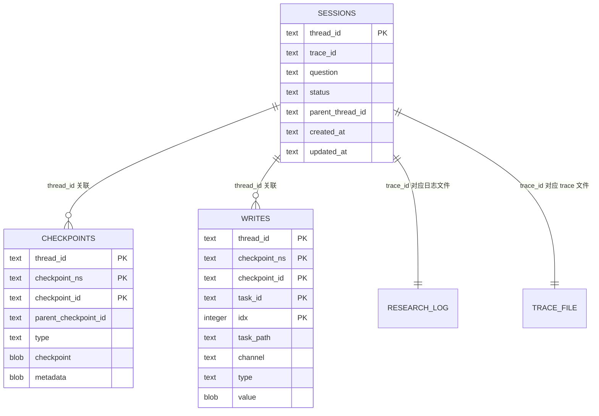

# 数据库设计文档

> 适用范围：当前 `main`（SQLite 单机持久化）
> 相关实现：[`persistence.py`](../persistence.py)、[`rag.py`](../rag.py)、[`tracing.py`](../tracing.py)、[`logging_utils.py`](../logging_utils.py)
> 默认位置：仓库根目录 `data/`（已 gitignore，可通过环境变量覆盖）

## 1. 存储总览

| 文件 | 格式 | 写入方 | 用途 | 是否 gitignore |
| --- | --- | --- | --- | --- |
| `data/sessions.sqlite` | SQLite | `persistence.SessionStore` | 历史会话索引（问题/状态/父会话/时间） | 是 |
| `data/checkpoints.sqlite` | SQLite | LangGraph `SqliteSaver` | 流程状态 checkpoint（断点恢复） | 是 |
| `data/kb_index.json` | JSON | `rag.KnowledgeBase` | 知识库分块 + BM25 统计 + 可选向量缓存 | 是 |
| `logs/research-<trace_id>.jsonl` | JSONL | `logging_utils.StepLog` | 结构化运行日志（每节点一行） | 是 |
| `logs/<trace_id>.trace.jsonl` | JSONL | `tracing.TraceRecorder` | 节点 Span + 运行汇总（Trace/成本） | 是 |
| `outbox/emails/*.eml` | 文本 | `tools.send_email`（dry-run） | 未配置 SMTP 时的模拟邮件 | 是 |
| `outbox/notion/*.md` | Markdown | `tools.save_to_notion`（dry-run） | 未配置 Notion 时的模拟页面 | 是 |

环境变量：

| 变量 | 默认值 |
| --- | --- |
| `AGENT_CHECKPOINT_DB` | `data/checkpoints.sqlite` |
| `AGENT_SESSIONS_DB` | `data/sessions.sqlite` |
| `AGENT_KB_INDEX` | `data/kb_index.json` |
| `AGENT_LOG_DIR` | `logs` |
| `AGENT_OUTBOX_DIR` | `outbox` |

## 2. 实体关系



一条“会话”= `sessions` 一行 + 该 `thread_id` 的若干 `checkpoints/writes` 行 + 两个日志文件；
删除会话时 `sessions` 与 `checkpoints/writes` 一起清，日志文件保留（审计）。

## 3. `sessions.sqlite` — 会话索引

### 3.1 建表语句（`persistence._SCHEMA`）

```sql
CREATE TABLE IF NOT EXISTS sessions (
    thread_id        TEXT PRIMARY KEY,
    trace_id         TEXT NOT NULL DEFAULT '',
    question         TEXT NOT NULL DEFAULT '',
    status           TEXT NOT NULL DEFAULT 'running',
    parent_thread_id TEXT NOT NULL DEFAULT '',
    created_at       TEXT NOT NULL,
    updated_at       TEXT NOT NULL
);
CREATE INDEX IF NOT EXISTS idx_sessions_updated ON sessions(updated_at DESC);
```

### 3.2 字段说明

| 字段 | 类型 | 说明 |
| --- | --- | --- |
| `thread_id` | TEXT PK | 会话唯一标识；web 端形如 `web-<trace_id>` |
| `trace_id` | TEXT | 8 位 hex，用于定位 `logs/` 下的日志与 trace 文件 |
| `question` | TEXT | 研究问题（截断到 500 字符） |
| `status` | TEXT | `running` / `interrupt` / `completed` / `interrupted` / `failed` |
| `parent_thread_id` | TEXT | 多轮追问时指向父会话，用于注入 `history_context` |
| `created_at` | TEXT | 首次创建时间（ISO 8601，带时区） |
| `updated_at` | TEXT | 最近一次状态/内容更新时间（列表按它倒序） |

### 3.3 状态机

```
running ──(到人工确认点)──> interrupt ──(resume 完成)──> completed
   │                          │
   │(后端报错)                │(用户终止)
   ▼                          ▼
 failed                    completed / terminated_by_user（见 final_output.status）
   │
   │(进程被杀/断网，无代码可执行)
   ▼
interrupted   ← 前端 POST /interrupt；或下次进程启动时统一清理遗留 running
```

### 3.4 写入路径

| 操作 | 方法 | SQL |
| --- | --- | --- |
| 创建/更新元数据 | `SessionStore.upsert` | `INSERT … ON CONFLICT(thread_id) DO UPDATE`（不覆盖已有 question/trace_id 的非空值） |
| 状态流转 | `SessionStore.set_status` | `UPDATE sessions SET status=?, updated_at=?` |
| 启动清理 | `SessionStore.mark_running_as_interrupted` | `UPDATE … SET status='interrupted' WHERE status='running'` |
| 删除 | `SessionStore.delete` | `DELETE FROM sessions WHERE thread_id=?` |

### 3.5 并发与可靠性

- 连接参数：`check_same_thread=False`，FastAPI 同步端点跑在线程池里；
- `PRAGMA journal_mode=WAL` + `busy_timeout=5000`：单写多读够用；
- `SessionStore` 内部用 `threading.RLock` 串行化写操作；
- 索引写失败只影响“历史列表”，不会让研究流程失败（`web.py` 中全部 try/except）。

## 4. `checkpoints.sqlite` — 流程状态（LangGraph 管理）

由 `langgraph-checkpoint-sqlite` 的 `SqliteSaver` 创建与读写，**不要手工改数据结构**。
实际表结构（本机 `PRAGMA table_info` / `sqlite_master` 实测）：

### 4.1 `checkpoints`

```sql
CREATE TABLE checkpoints (
    thread_id            TEXT NOT NULL,
    checkpoint_ns        TEXT NOT NULL DEFAULT '',
    checkpoint_id        TEXT NOT NULL,
    parent_checkpoint_id TEXT,
    type                 TEXT,
    checkpoint           BLOB,
    metadata             BLOB,
    PRIMARY KEY (thread_id, checkpoint_ns, checkpoint_id)
);
```

| 字段 | 说明 |
| --- | --- |
| `thread_id` | 会话 ID（与 `sessions.thread_id` 一致） |
| `checkpoint_ns` | 命名空间，单图场景通常为空串 |
| `checkpoint_id` | 每个 super-step 的 checkpoint ID |
| `parent_checkpoint_id` | 上一个 checkpoint（形成链） |
| `type` | 序列化类型标记 |
| `checkpoint` | 序列化后的 `ResearchState`（BLOB） |
| `metadata` | 图运行元数据（BLOB） |

### 4.2 `writes`

```sql
CREATE TABLE writes (
    thread_id      TEXT NOT NULL,
    checkpoint_ns  TEXT NOT NULL DEFAULT '',
    checkpoint_id  TEXT NOT NULL,
    task_id        TEXT NOT NULL,
    task_path      TEXT NOT NULL DEFAULT '',
    idx            INTEGER NOT NULL,
    channel        TEXT NOT NULL,
    type           TEXT,
    value          BLOB,
    PRIMARY KEY (thread_id, checkpoint_ns, checkpoint_id, task_id, idx)
);
```

| 字段 | 说明 |
| --- | --- |
| `task_id` / `task_path` | 产生写入的任务标识 |
| `idx` | 同任务内写入序号 |
| `channel` | 状态通道名（节点返回的字段） |
| `value` | 序列化后的字段值（BLOB） |

### 4.3 生命周期与删除

- 人工确认点（`interrupt`）会把状态写盘，服务重启后可用同一 `thread_id` + `Command(resume=...)` 恢复；
- 删除会话时通过 `persistence.delete_thread_data()` 清理：

```sql
DELETE FROM writes      WHERE thread_id = ?;
DELETE FROM checkpoints WHERE thread_id = ?;
```

- 该操作在独立连接上执行（`WAL` + `busy_timeout`），不删除 `logs/` 与 trace 文件；
- 单库会持续增长（本机实测 ~14 MB），长期运行需要定期清理已完成会话。

## 5. `kb_index.json` — 知识库索引缓存

结构（`rag.KnowledgeBase._save_cache`）：

```json
{
  "model": "text-embedding-3-small",
  "signature": [
    { "path": "langgraph-hitl.md", "mtime": 1731000000, "size": 774 }
  ],
  "chunks": [
    {
      "doc_id": "langgraph-hitl",
      "title": "LangGraph 人工中断（human-in-the-loop）",
      "heading": "三种人工确认",
      "chunk_id": 2,
      "text": "…chunk 正文…",
      "url": "kb://langgraph-hitl.md#2"
    }
  ],
  "vectors": [[0.0123, -0.0456, "…2048 维…"]]
}
```

| 字段 | 说明 |
| --- | --- |
| `model` | embedding 模型名；为空表示“纯 BM25”索引 |
| `signature` | 知识库文件快照（相对路径/mtime/size）；任一文件变化即重建 |
| `chunks` | 分块结果（含 heading 路径，引用可定位到小节） |
| `vectors` | 与 `chunks` 一一对应的向量；无 embedding 时缺省/为空 |

失效规则：`signature` 或 `model` 与当前不一致 → 重新分块/重新 embedding；
写入失败只打印提示，不影响在线检索（降级 BM25）。

## 6. 结构化日志 `logs/research-<trace_id>.jsonl`

每行一条节点日志（`state.LogEntry`），字段固定：

| 字段 | 类型 | 说明 |
| --- | --- | --- |
| `step_id` | string | 全局递增，形如 `S001` |
| `node_name` | string | 节点名（与 `graph._node_functions()` 一致） |
| `tool_name` | string | 工具名，无工具为空串 |
| `input_summary` | string | 输入摘要（已截断/脱敏） |
| `output_summary` | string | 输出摘要 |
| `status` | string | `ok` / `degraded` / `error` / `rejected` / `skipped` / `approved` / `revise` / `terminated` |
| `retry_count` | int | 本步骤重试次数 |
| `latency_ms` | int | 耗时（毫秒） |
| `error` | string/null | 错误信息（≤300 字符） |
| `timestamp` | string | ISO 8601 |
| `trace_id` | string | 链路 ID |

## 7. 调用链 `logs/<trace_id>.trace.jsonl`

两种行：`type=span` 与 `type=summary`。

### 7.1 span

| 字段 | 说明 |
| --- | --- |
| `type` | 固定 `span` |
| `trace_id` / `span_id` | 链路与节点实例 ID（`<node>-<time_ns>`） |
| `node` | 节点名 |
| `started_at` | 起始时间（ISO 8601，毫秒精度） |
| `latency_ms` | 节点耗时 |
| `status` | `ok` / `error` |
| `attempt` | 尝试次数 |
| `model` | 模型名（无调用为空串） |
| `prompt_tokens` / `completion_tokens` / `total_tokens` / `calls` | 本节点 token 用量 |
| `cost_cny` / `cost_estimated` | 成本与是否估算（价目表未命中为 true） |
| `error` | 失败信息 |

### 7.2 summary

`type=summary`，含 `trace_id`、`finished_at`，以及运行汇总：
`status / duration_ms / model / prompt_tokens / completion_tokens / total_tokens /
llm_calls / cost_cny / cost_estimated / price_source / node_count /
token_usage_by_node / cost_by_node`。

约束：各节点 `total_tokens` 之和等于运行总 token（有单测断言）；`/api/trace` 按 `started_at` 排序返回。

## 8. dry-run 产物

| 路径 | 内容 |
| --- | --- |
| `outbox/emails/<时间>-<id>-<收件人>.eml` | MIME 邮件（未配置 SMTP 时） |
| `outbox/notion/<时间>-<id>-<标题>.md` | Notion 页面 Markdown（未配置 Token 时） |

只在人工确认后写入；确认前 outbox 必须为空（有测试断言）。

## 9. 数据生命周期与运维建议

1. **备份**：停服务后直接复制 `data/*.sqlite` 与 `logs/`；
2. **清空**：删除会话用接口（会清 checkpoint），或停服删除 `data/` 下文件并删 `logs/`；
3. **不要多进程写**：SQLite 单写者模型，不要起多个 uvicorn worker；
4. **日志不自动清理**：`logs/` 与 trace 文件会持续累积，建议按天归档/清理；
5. **不要提交运行数据**：`data/`、`logs/`、`outbox/`、`evaluation/results/` 均已在 `.gitignore`；
6. **迁移到多实例**：把 `SessionStore` 换 Postgres 表、`build_checkpointer()` 换 `PostgresSaver` 即可（`persistence.py` 已是单点替换位）。
